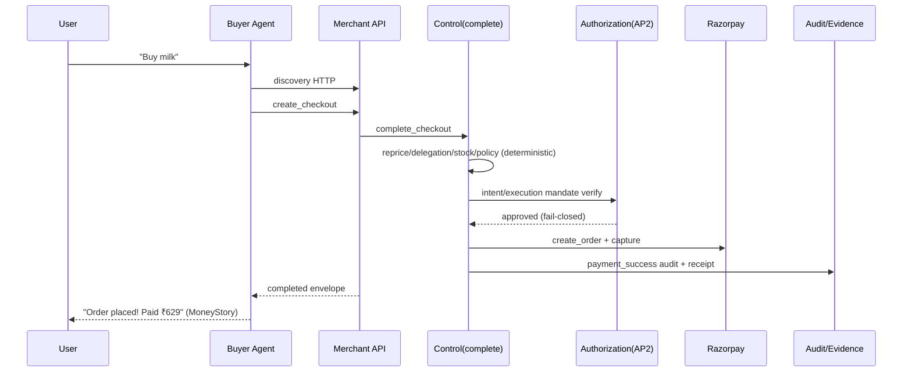

# CODEBASE ARCHAEOLOGY REPORT

**Project:** Agentic Commerce Gateway (ACG) — Razorpay AI Buildathon
**Date of audit:** 2026-08-29
**Method:** Read-only codebase archaeology & reconstruction (no file modified/moved/deleted)
**Product goal:** *Build an agent that makes a merchant transactable by an AI buyer end-to-end.*
**Required bar:** *Every money action must be explainable, bounded and gated. Show the audit trail and one failure handled gracefully.*

**Normative task spec:** `dir-reconstruct.md.md` (40 phases, 7 required tables, WAIT-FOR-APPROVAL gate before restructuring).
**Evidence convention (from spec):** every conclusion cited as `file → symbol → line → effect`; documentation treated as CLAIM, source/runtime as FACT.

---

## 1. Executive Summary

ACG is a **bounded agentic commerce gateway**: a deterministic, policy-enforcing grocery merchant that an AI buyer agent can transact with end-to-end over a versioned protocol, driving real Razorpay **test-mode** payments. The architecture cleanly separates **LLM reasoning** (buyer + merchant agent) from **money-critical control** (deterministic gating, price resolution, stock, checkout state machine).

**Who thinks / decides / enforces / executes / stores / proves / audits** (Phase 29 mental model):

| Role | Component | Evidence |
|---|---|---|
| THINKS | Buyer agent (`buyer_service/agent.py`), merchant agent (`merchant_agent/agent/`) | LLM loops with bounded tool calls |
| DECIDES | `gating_service.py`, `checkout_service.complete_checkout`, `authorization_service.py` | deterministic, no LLM |
| ENFORCES | `checkout_service._gate`/`_fail`, `gating_service.py:5` rules | re-run at completion |
| EXECUTES | `payment_service.py` → Razorpay | only route |
| STORES | `db.py` → SQLite (WAL) | `data/merchant.db` |
| PROVES | `crypto_service.py`, `provenance_service.py` (Ed25519) | AP2-inspired layer |
| AUDITS | `audit_service.py` (SHA-256 chain) | `admin`, `audit`, `provenance` APIs |

**AP2-landing:** The AP2-inspired layer is **PARTIALLY** implemented, not full AP2. It adds working **tamper-evident recording** (canonical-JSON Ed25519 signatures over Intent/Execution Mandates, Policy Decisions, Decision Receipts; SHA-256 append-only chain with a signed head anchor; an enforcement gate connecting "what buyer authorized" to "what was executed", fail-closed pre-money). Structural limits remain: **amount authority is merchant-server-side** (not an independent external signer), and **mandate verification artifacts live in the same SQLite DB** as the enforced state (a live attacker with DB write can rewrite both). See §15 and Table 7.

**Readiness posture (inherited audit verdicts, treated as claims):**
- `AUDIT.md` (2026-08-23): PRD conformance **74/100**, track **76/100**, three critical money-safety gaps (C-1 amount-binding, C-2 terminal-state callback, C-3 finaliser bypass) + C-4 entire merchant agent uncommitted.
- `FINAL_AUDIT.md` (2026-08-24): **NEARLY READY**; 53/53 tests pass in its own run; all bypass attempts rejected; hash chain intact.
- `AP2-post-audit.md` (2026-08-28): AP2 layer **PARTIALLY** — recording works, authority & independent-verifiability limits as above.

**As of THIS audit,** the git state shows the repo is still *dirty*: ~66 modified files and **9 untracked files** (the AP2 modules, AP2 tests, `scripts/_bench.py`, and the two AP2 audit docs). The AP2 source files are **not yet committed** — a continuation of the C-4 submission-integrity risk.

---

## 2. Repository Inventory

### Repository Tree (current structure, preserved)

```
rz-agent/
├─ .env.example                  # config template (tracked)
├─ .gitignore                    # modified/uncommitted: now ignores secrets/, dist/, .pytest_cache/
├─ requirements.txt              # pinned deps (tracked)
├─ README.md                     # claims source (modified/uncommitted)
│
├─ protocol/
│  ├─ protocol_spec.md           # versioned protocol doc (tracked)
│  └─ schemas/                   # JSON Schemas (tracked, NOT enforced at runtime)
│     ├─ audit_event.json  basket_proposal.json  checkout_session.json
│     ├─ error.json  product.json
│
├─ buyer_b/                      # independent second protocol client (tracked)
│  └─ client.py
├─ buyer_service/                # Buyer Agent service :8001 (tracked, mostly modified)
│  ├─ main.py  config.py  agent.py  prompts.py  conversations.py  tools.py
│
├─ merchant_agent/               # Merchant service :8000
│  ├─ main.py  config.py  db.py
│  ├─ api/        admin.py agent.py audit.py checkout.py discovery.py
│  │              provenance.py (UNTRACKED — AP2)
│  ├─ services/   checkout_service.py gating_service.py inventory_service.py
│  │              delegation_service.py discovery_service.py explain_service.py
│  │              payment_service.py audit_service.py
│  │              authorization_service.py crypto_service.py provenance_service.py (UNTRACKED — AP2)
│  ├─ models/     dto.py entities.py
│  ├─ agent/      loop.py prompts.py state.py tools.py
│  ├─ seed/       catalog.json
│  └─ tests/      (14 test files incl. 3 UNTRACKED AP2/e2e tests)
│
├─ dashboard/                    # React/Vite frontend :5173
│  ├─ index.html  package.json  package-lock.json  vite.config.js
│  ├─ src/ api.js  App.jsx  main.jsx  styles.css
│  │  ├─ views/       ChatView.jsx OpsView.jsx
│  │  ├─ components/  AuditTimeline.jsx MerchantAgentTrace.jsx MoneyStoryDrawer.jsx
│  │  │               PaymentCard.jsx RazorpayPayCard.jsx MessageBubble.jsx
│  │  │               CategoryIcon.jsx QuickReplyChips.jsx WorkingShimmer.jsx
│  │  ├─ utils/       actionMeta.js events.js
│  │  └─ theme/       tokens.css
│  └─ dist/                       # BUILT assets — gitignored (untracked)
│
├─ scripts/                      # demo/seed/test tooling
│  ├─ seed_catalog.py  reset_demo.py  scenario_check.py
│  ├─ audit_bypasses.py  audit_smoke.py  simulate_stock_failure.py
│  ├─ demo_merchant_agent.py  test_buyer_flow.py
│  └─ _bench.py                  # UNTRACKED benchmark
│
├─ AUDIT.md  AUDIT_REPORT.md  FINAL_AUDIT.md
├─ AUDIT_MERCHANT_AGENT_V1.md  AP2audit.md  AP2-post-audit.md
└─ data/  secrets/               # gitignored runtime artifacts (NOT shipped)
   ├─ data/merchant.db (+-wal,-shm), merchant.db.bak_e2e, logs
   └─ secrets/merchant_signing_key.pem  (119 bytes; existence only)
```

**Git state (HEAD = `457cbfc`):**
- **~66 modified** tracked files (uncommitted work — principal-agent layer + AP2 layer live only in the working tree).
- **9 untracked** files: `AP2audit.md`, `AP2-post-audit.md`, `merchant_agent/api/provenance.py`, `merchant_agent/services/{authorization_service,crypto_service,provenance_service}.py`, `merchant_agent/tests/{test_ap2_fixes,test_ap2_provenance,test_e2e_flow}.py`, `scripts/_bench.py`.
- 10 commits; three named "Baseline"/"wip"/"restore" commits document a **rollback** (`62706c0` wip cart-centric → `1c00eee` restore bill-centric → `32da896` Baseline Merchant Agent v1).

### Table 1 — Complete File Classification

| File | Actual Responsibility | Layer | Active? | Duplicate? | Dead? | Proposed Location |
|---|---|---|---|---|---|---|
| `README.md` | Product claims & demo instructions | Documentation | Modified | — | No | `docs/README.md` |
| `requirements.txt` | Deps | Config | Active | — | No | keep root |
| `.env.example` | Config template | Config | Active(modified) | — | No | keep root |
| `protocol/protocol_spec.md` | Protocol contract | Protocol | Active(partly stale) | — | No | `protocol/` |
| `protocol/schemas/*.json` | Published schemas (unenforced) | Protocol | Active(unused) | — | No | `protocol/schemas/` |
| `buyer_b/client.py` | Independent protocol client | Agent(2nd client) | Active | Partial vs buyer_service/tools | No | `buyer_b/` |
| `buyer_service/agent.py` | Buyer LLM loop | Agent reasoning | Active(modified) | — | No | `buyer/` |
| `buyer_service/tools.py` | Buyer protocol methods | Agent/Protocol | Active(modified) | Partial vs buyer_b | No | `buyer/` |
| `buyer_service/prompts.py` | Buyer prompts | Agent reasoning | Active(modified) | — | No | `buyer/` |
| `buyer_service/conversations.py` | Session state | Agent runtime | Active(modified) | — | No | `buyer/` |
| `buyer_service/main.py` | Buyer API | API/transport | Active(modified) | — | No | `buyer/` |
| `buyer_service/config.py` | Buyer config | Config | Active(modified) | — | No | `buyer/` |
| `merchant_agent/main.py` | Merchant FastAPI app (mounts routers) | API/transport | Active(modified) | — | No | `merchant/` |
| `merchant_agent/config.py` | Merchant config | Config | Active(modified) | — | No | `merchant/` |
| `merchant_agent/db.py` | SQLite/WAL/lock | Persistence | Active(modified) | — | No | `merchant/` |
| `merchant_agent/api/agent.py` | `/agent_sessions` routes | API | Active(modified) | — | No | `merchant/api/` |
| `merchant_agent/api/checkout.py` | Checkout/payment/complete/callback/reconcile | API+Domain | Active(modified) | — | No | `merchant/api/` |
| `merchant_agent/api/admin.py` | Admin/ops/demo-reset | API(admin) | Active(modified) | — | No | `merchant/api/` |
| `merchant_agent/api/audit.py` | Audit/verify/explain reads | API | Active(modified) | — | No | `merchant/api/` |
| `merchant_agent/api/discovery.py` | Search/products | API | Active(modified) | — | No | `merchant/api/` |
| `merchant_agent/api/provenance.py` | `/provenance/{id}`, `/mandates/intents` | API(AP2) | **UNTRACKED** | — | No | `merchant/api/` |
| `merchant_agent/services/checkout_service.py` | Ladder: price/stock/policy/payment finaliser | Domain+Control | Active(modified) | — | No | `merchant/domain+control/` |
| `merchant_agent/services/gating_service.py` | 5 policy rules | Deterministic control | Active | — | No | `merchant/control/` |
| `merchant_agent/services/inventory_service.py` | Reservations/TTL/sweep | Domain | Active | — | No | `merchant/domain/` |
| `merchant_agent/services/delegation_service.py` | Delegation caps/expiry | Control | Active | — | No | `merchant/control/` |
| `merchant_agent/services/discovery_service.py` | Search synonyms/stopwords | Domain | Active | — | No | `merchant/domain/` |
| `merchant_agent/services/explain_service.py` | Decision explanation | Explainability | Active(H-1 bug) | — | No | `merchant/control/` |
| `merchant_agent/services/payment_service.py` | Razorpay drivers | Payment | Active | — | No | `merchant/payment/` |
| `merchant_agent/services/audit_service.py` | SHA-256 hash chain | Audit/evidence | Active | — | No | `merchant/evidence/` |
| `merchant_agent/services/authorization_service.py` | Mandate serialization/verification | Authorization(AP2) | **UNTRACKED** | — | No | `merchant/ap2/` |
| `merchant_agent/services/crypto_service.py` | Ed25519/canonical JSON | Crypto(AP2) | **UNTRACKED** | — | No | `merchant/ap2/` |
| `merchant_agent/services/provenance_service.py` | Provenance/receipts (AP2) | Evidence(AP2) | **UNTRACKED** | — | No | `merchant/ap2/` |
| `merchant_agent/models/dto.py` | DTOs + ErrorCode/protocol errors | Protocol/domain | Active(modified) | — | No | `merchant/domain/` |
| `merchant_agent/models/entities.py` | ORM entities | Persistence | Active(modified) | — | No | `merchant/persistence/` |
| `merchant_agent/agent/loop.py` | Merchant agent observe-reason-act loop | Agent reasoning | Active(modified) | — | No | `merchant/agent/` |
| `merchant_agent/agent/tools.py` | 12-tool allowlist | Agent runtime | Active(modified) | — | No | `merchant/agent/` |
| `merchant_agent/agent/prompts.py` | Merchant prompts | Agent reasoning | Active | — | No | `merchant/agent/` |
| `merchant_agent/agent/state.py` | In-memory agent sessions | Agent runtime | Active(in-memory) | — | No | `merchant/agent/` |
| `merchant_agent/seed/catalog.json` | Product/pack/substitution seed | Data | Active | — | No | `merchant/seed/` |
| `dashboard/src/**` | Frontend | Presentation | Active(modified) | — | No | `dashboard/` |
| `scripts/*.py` | Demo/seed/test tooling | Tooling | Mixed (see §22) | — | Some | `scripts/` |
| `AUDIT*.md` `FINAL_AUDIT.md` | Historical audits (CLAIMS) | Documentation | Stale lineage | Duplicated | — | `docs/audits/` |
| `AP2audit.md` `AP2-post-audit.md` | AP2 audits (CLAIMS) | Documentation | **UNTRACKED** | — | — | `docs/audits/` |
| `data/`, `secrets/`, `dist/`, logs | Runtime artifacts | — | gitignored | — | — | NOT shipped |

---

## 3. Documentation Reality vs Implementation Reality

### Documentation Lineage (which supersedes which)

```
62706c0 wip cart-centric ──(rolled back)──> 1c00eee restore bill-centric ──> 32da896 Baseline v1
                                                                              │
        AUDIT.md (2026-08-23, 74/100 PRD) ◄── AUDIT_REPORT.md (interim A–H only)
              │
        AUDIT_MERCHANT_AGENT_V1.md (2026-08-24, code-inspection only, tests unverifiable)
              │
        FINAL_AUDIT.md (2026-08-24, "NEARLY READY", 53/53 passing verified on-runner)
              │
        AP2audit.md (CURRENT system audit, lists PARTIALLY/EXISTS/MISSING tables)
              │
        AP2-post-audit.md (2026-08-28, post-AP2 verdict: PARTIALLY)
              ▼
        **THIS ARCHAEOLOGY REPORT** (2026-08-29, unifies all above as CLAIMS)
```

The audit docs overlap heavily and contradict one another on several counts (§9.2 of `AUDIT.md` catalogues its own contradictions with `AUDIT_REPORT.md`). All are treated below as **CLAIMS**, not implementation evidence.

### Critical documented conflicts (spec: DOCUMENTATION CLAIM / IMPLEMENTATION REALITY / CONFLICT / SOURCE OF TRUTH)

**1. Error enum drift (protocol schema vs code):**
- DOCUMENTATION CLAIM: `protocol/schemas/error.json` defines the machine-readable error enums for the protocol.
- IMPLEMENTATION REALITY: `merchant_agent/models/dto.py` `ErrorCode` enum now includes AP2 codes `PAYMENT_BLOCKED` and `PROVENANCE_NOT_FOUND` (plus pre-existing ones), served via `ProtocolError`.
- CONFLICT: `error.json` does **not** list `PAYMENT_BLOCKED`/`PROVENANCE_NOT_FOUND`.
- SOURCE OF TRUTH: `models/dto.py` (runtime served); `error.json` is a schema published but **never enforced** anywhere.
- RISK: a protocol consumer validating responses against `error.json` would reject legitimate AP2 error envelopes.

**2. Reservation lifecycle unaudited (AUDIT.md J10):**
- DOCUMENTATION CLAIM: audit trail is "comprehensive" ("append-only audit trail with SHA-256 hash chaining").
- IMPLEMENTATION REALITY: `inventory_service.py` reservation release/consume/expire/sweep writes **no audit events**; `delegation_service` expiry likewise writes nothing.
- CONFLICT: "comprehensive" is inaccurate for reservation lifecycle.
- SOURCE OF TRUTH: `audit_service.append_event` call sites (single write path) — no reservation lifecycle callers.

**3. Empty policy grid on completion-time decline (AUDIT.md H-6):**
- DOCUMENTATION CLAIM: OpsView renders a policy-checks grid for every decision.
- IMPLEMENTATION REALITY: `checkout_service._fail` (decline path) writes `final_validation` with **no payload**; approved path writes full `checks` array. `OpsView.jsx` renders `payload?.checks || []` → **blank** on decline.
- CONFLICT: UI claim not backed by backend on the failure path.
- SOURCE OF TRUTH: `checkout_service.py` `_fail` event payload vs `OpsView.jsx` renderer.

**4. No concurrent-reservation test (AUDIT_MERCHANT_AGENT_V1.md §13.9):**
- DOCUMENTATION CLAIM: A "concurrent reservation safety" behavior is asserted.
- IMPLEMENTATION REALITY: `test_inventory.py` has no `threading`/`concurrent` usage; `pack_chicken_500` stock=1 fixture exists but no test exercises concurrent reservation.
- CONFLICT: safety claim not proven by any test.
- SOURCE OF TRUTH: test files (grep for threading/concurrent = none in tests).

**5. Amount-recording (C-1):** README claims terminal-state protection and amount integrity; `checkout_service.py:759-763` reuses a Razorpay order id without binding the revalidated total to the charged amount. See §18.

**6. Test-count drift:** README "34 pytest cases" vs actual (48 in `AUDIT.md`, 53 in `FINAL_AUDIT.md`, plus AP2/e2e tests now = more). README claim is stale/understated.

**7. `.gitignore` now ignores `secrets/`** (the Ed25519 signing key) — this is a NEW, uncommitted modification, correct and important (key must never ship).

---

## 4. Current Architecture

**Layer inventory (16 layers from spec) mapped to code:**

| Spec layer | Implemented by | Notes |
|---|---|---|
| 1 Agent reasoning | `buyer_service/agent.py`, `merchant_agent/agent/{loop,prompts}.py` | LLM calls to Groq |
| 2 Agent runtime/orchestration | `merchant_agent/agent/{state,tools}.py`, `api/agent.py` | 12-tool allowlist, budgets |
| 3 API/transport | `merchant_agent/api/*`, `buyer_service/main.py` | FastAPI, CORS `*` |
| 4 Protocol | `protocol/protocol_spec.md`, `models/dto.py` | schemas unenforced |
| 5 Domain/commerce | `services/checkout_service.py`, `inventory_service.py`, `discovery_service.py` | price/stock logic |
| 6 Deterministic control | `services/gating_service.py`, `delegation_service.py` | no LLM |
| 7 Authorization/mandates | `services/authorization_service.py` (AP2) | **UNTRACKED** |
| 8 Cryptographic provenance | `services/crypto_service.py`, `provenance_service.py` (AP2) | **UNTRACKED** |
| 9 Payment/Razorpay | `services/payment_service.py` | 3 drivers |
| 10 Persistence/database | `db.py`, `models/entities.py` | SQLite WAL + mutation lock |
| 11 Audit/evidence | `services/audit_service.py` | SHA-256 chain |
| 12 Presentation/dashboard | `dashboard/src/**` | React/Vite |
| 13 Configuration | `config.py` (both), `.env.example` | pydantic-settings |
| 14 Test | `merchant_agent/tests/**` | 14 files |
| 15 Demo/tooling | `scripts/**` | mixed |
| 16 Documentation | README, protocol, audits | claims |

**Bidirectional trust boundary — clean and intentional:** buyer can reach merchant *only* via HTTP protocol; merchant agent can influence money *only* through deterministic services it cannot override. This is the strongest architectural property and is verified by imports (`buyer_service/` has no merchant DB/payment modules) and by `api/checkout.py` / `checkout_service.py` placing all money authority behind `_gate`/`_fail`/`_finalize_payment` and the `mutation_lock`.

---

## 5. File-by-File Semantic Inventory

> Full 20-field structured records per spec Phase 3. Space-efficient: fields captured per file; trivial repeated fields (imports of stdlib) grouped.

### `merchant_agent/db.py` (111 lines) — Persistence layer
- **Purpose/responsibility:** SQLite connection (WAL mode), process-wide `mutation_lock`, `mutate()`/`read_only()` transaction helpers, `init_db`. Single write funnel.
- **Imports by:** all services/apis. **State mutated:** whole DB via `mutate()`.
- **Side effects:** file I/O on `data/merchant.db`; WAL shared-memory needs write access.
- **Security critical:** yes (serializes writes to prevent DB corruption; the AP2 limitation is that mandates live in the same DB the write path can modify — see §15).
- **Tests:** conftest repoints DB to tmp; exercised throughout suite.

### `merchant_agent/models/entities.py` (222 lines) — ORM
- **Entities:** `Product`, `Pack`, `Category`, `Delegation`, `CheckoutSession`, `Reservation`, `AuditEvent`, `SavedPaymentMethod`, `IdempotencyKey`, plus AP2 tables (mandates, receipts, etc. per add).
- **Immutables:** price, pack_id, session id; **mutable:** stock, session status/version/totals, order ids, reservation flags.
- **State machine:** surfaced via `VALID_TRANSITIONS` in `checkout_service` (not in entity).
- **Tests:** covered across state/checkout/inventory tests.

### `merchant_agent/models/dto.py` (289 lines) — DTOs + errors
- **Public:** `LineItem`, `CheckoutSessionOut`, `ProductOut`, `TokenizeRequest`, `ErrorCode` (incl. AP2 `PAYMENT_BLOCKED`, `PROVENANCE_NOT_FOUND`), `ProtocolError` (fields: `http_status`, `retryable`, `details`, `session_ref`), `MoneyStoryOut`, etc.
- **Money key:** `LineItem` accepts only `pack_id`+`quantity` — price is **never client-supplied** (server-authoritative).
- **Tests:** `test_audit_and_errors.py` uses error path.

### `merchant_agent/services/gating_service.py` — Deterministic control
- **5 rules:** `delegation_expiry`, `category_allowed`, `quantity_limit`, `spend_limit`, `stock_check`. Pure functions, no LLM import. Returns `(allowed, reason)` or decision + `FAILURE_CODES` map.
- **Tests:** `test_gating.py` (9 cases).

### `merchant_agent/services/inventory_service.py` — Inventory/reservations
- **Reservations** with `RESERVATION_TTL_MINUTES`, `sweep_expired`, deliberate TOCTOU surface (reservation does NOT shield actual stock). Dual stock check at completion.
- **Concern:** lifecycle unaudited (J10); silent oversell clamp `max(0, …)`.

### `merchant_agent/services/delegation_service.py` — Delegation caps
- Caps (category/quantity/spend) + expiry; re-validated at completion. No revocation endpoint.

### `merchant_agent/services/discovery_service.py` — Search
- `STOPWORDS`/`SYNONYMS` incl. Hindi; deterministic fallback behind LLM parse.

### `merchant_agent/services/explain_service.py` — Explainability
- **H-1 bug:** iterates `rules_fired` (a JSON **string**) as a list → create-time declines misreport. (See §25, Table 7.)

### `merchant_agent/services/checkout_service.py` (1257 lines) — Domain + Control core
- **Functions of note:** `_resolve_items` (authoritative price), `_compute_totals`, `create_checkout`, `update_checkout` (reprice), `confirm_checkout`, `complete_checkout` (the completion ladder ~596-780), `_gate`, `_fail` (release+decline+audit), `_finalize_payment` (896-978), `finalize_with_outcome`, `reconcile_session` (993), `_assert_transition`, `serialize_session`.
- **Money/safety:** completion ladder order = idempotent replay → ownership → terminal short-circuit → transition → reprice → delegation re-check → dual stock → policy re-run → Razorpay. `_fail` writes "Razorpay NOT called".
- **Defects (claims from AUDIT.md):** C-1 amount-binding (`:759-763`), C-3 `_finalize_payment` bypasses `_assert_transition`, H-6 `_fail` omits checks payload.
- **Tests:** `test_checkout_flow.py`, `test_inventory.py`, `test_saved_driver.py`, `test_state_machine.py`, AP2 tests.

### `merchant_agent/services/payment_service.py` (397 lines) — Payment
- **Drivers:** `saved`(default) / `checkout` / `sim`(rejected outside pytest unless `ACG_TEST_ALLOW_SIM=1`). Real `razorpay.Client`, `verify_checkout_signature` (fail-closed), `create_order` (H-8: fails OPEN with `order_sim_` when creds missing).
- **Modal fallback** `:830-845` after token-charge rejection (reused stale order — the C-1 surface).
- **Tests:** `test_saved_driver.py`.

### `merchant_agent/services/audit_service.py` — Audit chain
- `append_event` (computes `prev_hash` + own SHA-256 over canonical serialization), `verify_chain`. Single write path.
- **Tests:** `test_audit_and_errors.py` (valid + tampered).

### `merchant_agent/services/{crypto_service,authorization_service,provenance_service}.py` (188/379/188 lines) — AP2 (UNTRACKED)
- **crypto_service:** Ed25519 key load-or-generate (`secrets/merchant_signing_key.pem`), canonical JSON, sign/verify, nonce, head-anchor sign.
- **authorization_service:** builds/verifies Intent + Execution Mandates, Policy Decisions; serializes signed payload.
- **provenance_service:** Decision Receipts, provenance records, disambiguation.
- See §15 for authority/signing semantics.

### `merchant_agent/agent/loop.py` (1064 lines) — Merchant agent
- observe→reason→act→adapt loop; `llm`/`fallback` brains; `_LEAKED_TOOLCALL_RE`, `_args_digest`; budgets (8 iterations / 10 tool calls); busy-lock 409; `finish(outcome="completed")`.
- **H-7:** accepts `finish(outcome="completed")` without verifying a payment occurred.
- **Tests:** `test_merchant_agent.py`, `test_agent_handoff.py`.

### `merchant_agent/agent/tools.py` (901 lines) — 12-tool allowlist
- Tools classified **READ / WRITE / FINANCIAL**. Named registry of 12. Financial tools supervised by deterministic gate.
- **Tests:** `test_merchant_agent.py`.

### `merchant_agent/agent/state.py` + `prompts.py`
- **state:** in-memory agent sessions (lost on restart). **prompts:** system prompts for merchant brain.

### `merchant_agent/api/checkout.py` (297 lines) — checkout/payment routes
- `/checkout_sessions` (POST/PUT/GET), `/complete`, `/cancel`, `/confirm`, `/payment_callback` (:179-239), `/reconcile`, `/tokenize`.
- **C-2:** callback checks only order-id-match + signature — no status/amount/ownership/idempotency.
- **Tests:** checkout/state/saved-driver tests; **no test hits `/payment_callback`**.

### `merchant_agent/api/{agent,admin,audit,discovery,provenance}.py`
- **agent:** `/agent_sessions` routes (4 endpoints) + `EXECUTION_MODES`.
- **admin:** `require_admin` →401, `ADMIN_TOKEN`; `/admin/demo/reset` deletes `AuditEvent` rows (H-5), `/admin/ops/status`.
- **audit:** `/audit_logs`, `/audit_logs/verify`, `/explain/{id}`.
- **discovery:** product search.
- **provenance (AP2, untracked):** `GET /provenance/{id}`, `POST /mandates/intents` (min()/intersection constraints_override).

### `merchant_agent/main.py` — app assembly
- `lifespan` → `init_db`; mounts routers (discovery/checkout/audit/provenance/agent/admin); `/health`; exception handler → structured envelope; `allow_origins=["*"]`.
- **Modified/uncommitted:** working tree mounts `agent.router` (HEAD did not).

### `buyer_service/*` — Buyer Agent
- `agent.py` (780 lines): buyer loop + `_ACK_WORDS` small-talk gate, `Conversation` dataclass (`intent_mandate_id`, `pending_substitution`, `substitution_rounds`), `ROLE_TAGS={"protein"}`, accept-by-default substitution policy.
- `tools.py`: 12 protocol methods over `MerchantClient` (httpx, idempotency header, returns `(status, json)`). `BILL_PAUSE="__BILL_PAUSE__"`.
- `config.py`: buyer LLM model (`openai/gpt-oss-20b`).
- `conversations.py`: session state. `main.py`: `:8001` API + SSE handlers.

### `buyer_b/client.py` — independent second client
- Pure protocol client, no shared code with `buyer_service/`; asserts replay idempotency returns same `payment_id`.

### `dashboard/src/**` — presentation
- `App.jsx` (theme toggle, integrity `/audit_logs/verify`, health poll), `ChatView.jsx` (SSE render, pendingBill/pendingSub, MoneyStory, suggestions), `OpsView.jsx` (polls `/admin/ops/status` 2.5s, RULE_LABELS/STATUS_VERB, RazorpayPayCard), `utils/events.js` (SSE→UI suppression, `SUPPRESSED_TYPES={'conversation_started','tool','found'}`), `utils/actionMeta.js` (ACTION_META dict), `components/AuditTimeline.jsx` (v2 rails/filters/stepper), `components/MerchantAgentTrace.jsx` (§39 style decision trace, `useAgentSessions`), `components/MoneyStoryDrawer.jsx` (composed from `/explain`+`/checkout_sessions`+`/audit_logs`, `latestChecks`), `components/PaymentCard.jsx` + `RazorpayPayCard.jsx` (two-stage E-Mandate → save-card reopen, `MANDATE_BLOCK_REASONS`), `components/MessageBubble.jsx` (safe **bold** richText), `components/WorkingShimmer.jsx`, `theme/tokens.css` + `styles.css` ("Clean Commerce" theme).
- **Hardcoded admin token** `admin_demo_token` in `src/api.js:13` (H-5).
- **UI claims vs backend:** H-6 (blank policy grid on decline); H-1 (explain panel wrong on create-time decline). `RazorpayPayCard`/`PaymentCard` perform real E-Mandate local reconciliation.

### `scripts/*` — tooling (see §22 classification)
- `seed_catalog`, `reset_demo`, `scenario_check`, `audit_bypasses`, `audit_smoke`, `simulate_stock_failure`, `demo_merchant_agent`, `test_buyer_flow`, `_bench` (untracked).

---

## 6. Symbol-Level Dependency Map

### Table 2 — Critical Symbol Inventory

| File | Symbol | Called By | Calls | Side Effects | Security Critical? | Money Critical? |
|---|---|---|---|---|---|---|
| `checkout_service.py` | `complete_checkout` | `api/checkout.py POST /complete` | `_gate`,`_fail`,`payment_service.create_order`,`_assert_transition` | DB write, reservations, Razorpay, audit | YES | YES |
| `checkout_service.py` | `_finalize_payment` | `api/checkout.py /payment_callback`, `finalize_with_outcome`, `reconcile_session` | stock decrement, reservation consume, audit | status→completed/declined/pending | YES | YES |
| `checkout_service.py` | `_gate` | `complete_checkout` | `gating_service` rules | decline/approve | YES | YES |
| `checkout_service.py` | `_fail` | `complete_checkout` | release reservations, audit | decline | YES | YES |
| `checkout_service.py` | `_resolve_items`/`_compute_totals` | create/update/complete | DB read | computes authoritative total | YES | YES |
| `gating_service.py` | `<5 rules>` | `_gate` | none (pure) | none | YES | YES |
| `payment_service.py` | `create_order` | `complete_checkout` | `razorpay.Client` | Razorpay order | YES | YES |
| `payment_service.py` | `verify_checkout_signature` | `api/checkout.py /payment_callback` | crypto | signature check | YES | YES |
| `payment_service.py` | `_sim_allowed` | create_order | — | gate | YES | YES |
| `audit_service.py` | `append_event` | all services | DB write | hash-chain event | YES | NO |
| `audit_service.py` | `verify_chain` | `api/audit.py` | DB read | integrity badge | YES | NO |
| `crypto_service.py` | `sign_canonical`/`verify` | `authorization_service`,`provenance_service` | key I/O | Ed25519 | YES | YES |
| `authorization_service.py` | `authorize`/`verify_mandate` | `checkout_service` gate | crypto + audit | mandate binding | YES | YES |
| `provenance_service.py` | `record_receipt` | authorization paths | DB write | evidence | YES | NO |
| `agent/loop.py` | `run`/`_llm_decide`/`_fallback_decide` | `api/agent.py` | tools, LLM | agent session | YES(overreach) | YES |
| `agent/tools.py` | `dispatch`(12 tools) | `loop.py` | services | varies by privilege | YES | YES |
| `api/checkout.py` | `payment_callback` | Razorpay webhook | `_finalize_payment` | completes session | YES | YES |
| `buyer_service/agent.py` | buyer loop + `resume_after_decision` | `main.py` SSE | `tools.py` | buyer LLM session | YES | NO |

### Dependency Graph (A → B, "imports/calls")

```
dashboard → API(merchant/buyer)            [HTTP; jsx/js → api.js → fetch/proxy]
buyer_service/agent.py → tools.py → MerchantClient → merchant API :8000   [HTTP only]
buyer_service → (NO merchant_agent import, NO DB, NO razorpay, NO gating)   [verified clean]
buyer_b/client.py → merchant API :8000    [independent, HTTP]
merchant_agent/main.py → api/* → services/* → {gating,delegation,inventory,payment,audit} → db
merchant_agent/agent/* → services/*       [agent may CALL services but never override policy]
authorization_service/crypto_service/provenance_service → audit_service → db
payment_service → razorpay(httpx) ; → payment_service ← checkout_service
config.py → pydantic-settings ; db.py → sqlalchemy/sqlite3
```

### Table 6 — Architecture Violations

| Finding | Location | Why Wrong | Severity | Target State |
|---|---|---|---|---|
| Domain logic in API layer | `api/checkout.py` holds order/amount/reuse logic | API should be thin transport | LOW | move to service |
| Payment call inside rollback-able `mutate()` | `api/checkout.py:101-136` | exception after gateway call could lose payment | MEDIUM(H-4) | move gateway call out of txn |
| Schema not enforced | protocol schemas published, never used to validate | doc/code drift (error.json) | MEDIUM | wire schema validation |
| Shared same-DB for mandates + state | `db.py` | live attacker can rewrite both (AP2 limit) | HIGH | separate signer/DB or external validator |
| CORS `*` | `main.py:36-41` | any origin can call APIs | MEDIUM | restrict origins |
| No prod→test import | — (verified clean) | — | — | — |

---

## 7. Runtime Entry Points

| Entry | Path | First Service | Terminal Action | Auth | Audit |
|---|---|---|---|---|---|
| FastAPI app | `merchant_agent/main.py` | `init_db` → routers | — | per-route | yes |
| Buyer API | `buyer_service/main.py` | buyer loop | agent session | none | buyer-side |
| Agent session | `api/agent.py` `/agent_sessions` | `agent/loop.run` | agent outcome | none | yes |
| Payment callback | `api/checkout.py` `/payment_callback` | `_finalize_payment` | completed | signature only | yes(C-2) |
| Reconciliation | `checkout_service.reconcile_session` | finaliser | completed/pending | none | yes |
| Admin reset | `api/admin.py` `/admin/demo/reset` | delete AuditEvent | wipe chain | `ADMIN_TOKEN` | n/a |
| DB init | `db.init_db` (lifespan) | create tables | — | — | — |

---

## 8. Golden Transaction Trace ("Buy milk")

```
USER "Buy milk"
→ buyer_service/agent.py (buyer LLM loop)        [LLM]
→ buyer_service/tools.py → MerchantClient → HTTP POST :8000   [deterministic HTTP]
→ merchant_agent/api/discovery.py → discovery_service   [search]
→ api/checkout.py POST /checkout_sessions → checkout_service.create_checkout
   → _resolve_items/_compute_totals (authoritative price)   [deterministic]
→ api/agent.py /agent_sessions → merchant agent loop (negotiation/substitution)   [LLM]
→ checkout_service.confirm/complete
→ complete_checkout ladder:
     idempotent replay → ownership → terminal-short-circuit → _assert_transition
     → re-price → delegation re-check → dual stock check → _gate (policy re-run)
     → authorization_service (AP2 mandate/gate)   [deterministic]
→ payment_service.create_order → Razorpay test order   [payment]
→ human approval → /complete → Razorpay capture → /payment_callback → _finalize_payment
→ reservations consume + stock decrement   [state]
→ provenance_service record_receipt + audit_service.append_event   [evidence]
→ RESPONSE: "Order placed! Paid ₹629" (MoneyStory / PaymentCard)   [UI]
```

**Per-arrow detail** (deterministic vs LLM, money impact): the only LLM steps are buyer discovery/negotiation and merchant agent substitution; every money-affecting step (`_compute_totals`, gating, authorization, Razorpay, finalizer) is deterministic and server-side.

### Golden Path Mermaid



---

## 9. Failure Transaction Traces

| # | Trigger | Function → Decision → State | Payment effect | Audit | User response |
|---|---|---|---|---|---|
| 1 | stock disappears between reservation & payment | `complete_checkout` dual-stock check fails → `STOCK_UNAVAILABLE`, `_fail` releases reservations | Razorpay NOT called, `retryable=True` | `final_validation` (no payload → H-6) | declined, retryable |
| 2 | spend limit exceeded (create-time) | `_gate` fails `spend_limit` at create | Razorpay NOT called | rules_fired + "NOT called" | declined; Explain bugged (H-1) |
| 3 | invalid mandate/signature (AP2) | `authorization_service.verify` fails → `PAYMENT_BLOCKED`/`PROVENANCE_NOT_FOUND` | fail-closed pre-money | signed decision | typed ProtocolError |
| 4 | Razorpay failure | `create_order`/capture error | no capture; modal fallback (C-1 surface) | payment_failure | modal |
| 5 | payment pending | `_finalize_payment` writes `payment_pending`, reconcile once | not completed | payment_pending | awaiting |
| 6 | duplicate completion (same Idempotency-Key) | replay returns original snapshot | no re-charge | replay event | original result |
| 7 | invalid state transition | `_assert_transition` (on `/complete`) rejects | none | — | error |
| 7b | **cancelled session paid via callback (C-2)** | `/payment_callback` lacks status check → `_finalize_payment` flips `cancelled`→`completed` | **charges a cancelled session** | completion | **BUG — money moves after cancel** |

Execution stops: on `/complete` at the first failing ladder check (Razorpay never reached). But on `/payment_callback` the finaliser bypasses transitions (C-2/C-3) — the strongest failure-path defect.

---

## 10. Data Lineage

### Table 3 — Data Lineage

| Data | Origin | Transformations | Storage | Validation | Consumers |
|---|---|---|---|---|---|
| `buyer_agent_id` | request header/body | passed through | session | ownership check (complete) | checkout, audit |
| `user intent` | user text | buyer LLM parse | conversation | small-talk gate | tools |
| `delegation id/token` | `delegation_service` | token mint/renew | DB | re-validated at completion | gating |
| `mandate id` | `authorization_service` (AP2) | intent/execution mandate | DB + signed | `verify_mandate` | gate |
| `product/pack id` | catalog | — | DB | present | resolve |
| `quantity` | buyer (client-supplied) | — | line item | policy `quantity_limit` | totals, stock |
| `unit price` | **DB (`pack.price`)** | never client | DB | authoritative | totals |
| `subtotal/tax/shipping/total` | `_compute_totals` | server-only; `SHIPPING_FEE=40`, `FREE_SHIPPING_THRESHOLD=999` | session.totals | reprice on update | payment, audit, UI |
| `authorized amount` | Razorpay order | **not bound to revalidated total (C-1)** | order | **none (C-1)** | finalizer(records session total, not order amount) |
| `checkout_session_id` | server UUID | — | DB | ownership | all |
| `razorpay order/payment id` | Razorpay | stored on session | DB | signature verify | finalizer, audit |
| `policy decision` | `_gate` | checks array (or empty on `_fail`) | audit | — | OpsView/MoneyStory |
| `receipt` | `provenance_service` | decision receipt | DB+signed | verify | UI, audit |
| `audit event` | `audit_service.append_event` | canonical JSON + SHA-256 chain | DB | `verify_chain` | IntegrityPanel |
| `hashes` | `audit_service` / `crypto_service` | prev_hash chain / Ed25519 head anchor | DB | recompute | integrity badge |
| `signatures` | `crypto_service` | over canonical JSON | DB(secrets/) | verify | AP2 |
| `nonce` | `crypto_service` | per-signature | DB | replay check | AP2 |

**Untrusted-input influence points:** quantity (buyer-supplied, policy-bounded); `buyer_agent_id` (ownership); mandate fields (verified); Idempotency-Key (H-2: unscoped). **Price cannot** be influenced by any client — the single cleanest lineage.

---

## 11. Source-of-Truth Map

| Concept | Current Source of Truth | Other Copies | Risk |
|---|---|---|---|
| price | `entities.Pack.price` (DB) | session.totals | reprice on update; low |
| stock | `entities.Pack.stock_actual` / `stock_reserved` | discovery advertises stock_actual | discovery/gating disagree on reservations |
| reservation | `Reservation` rows | — | lifecycle unaudited |
| total | `session.totals` (server) | audit line (may record wrong amount, C-1) | C-1 divergence |
| checkout state | `session.status` | audit events | callback bypass (C-2) |
| authorization | `authorization_service` mandates | — | same-DB |
| delegation | `Delegation` row | — | no revocation |
| payment state | Razorpay + session | audit | callback not amount-checked |
| audit | `AuditEvent` chain | — | erasable via reset (H-5) |
| mandate | `authorization_service` + signed | same-DB state | attacker rewrite |
| signature | `crypto_service` keys | secrets/ | key mgmt |
| receipt | `provenance_service` | same-DB | — |

**Competing sources of truth:** (1) discovery `stock_actual` vs gating `stock_actual - reservations`; (2) audit `payment.amount` (session total) vs Razorpay authorised amount (C-1); (3) `models/dto.py` ErrorCode vs `error.json` schema.

---

## 12. Buyer Agent Architecture

- **Knows:** catalog through discovery, its own intent, delegation bounds (as disclosed), protocol surface only.
- **Can read/call:** 12 protocol methods via `tools.py` / `MerchantClient`. 
- **Can decide:** item selection, substitutions (accept-by-default), when to request human approval.
- **Cannot access:** merchant DB, Razorpay, gating, policy internals (verified: no such imports).
- **LLM reasoning:** `agent.py` loop; protected by `_ACK_WORDS` small-talk gate and deterministic approval gate (`resume_after_decision:412+`) that no LLM can argue past.
- **Money impact:** none directly — only constructs proposals the merchant authorizes.

---

## 13. Merchant Agent Architecture

- **Observes:** checkout request, buyer proposal, catalog.
- **Reasons:** `loop.py` with `llm`/`fallback` brains, `_LEAKED_TOOLCALL_RE`/`_args_digest` sanitization.
- **Tools:** 12-tool allowlist, classified READ/WRITE/FINANCIAL, budgets (8 iterations / 10 tool calls), busy-lock→409.
- **Cannot control:** cannot override policy/payment; deterministic services can overrule it.
- **Boundary:** `finish(outcome="completed")` verified only post-hoc (H-7: no payment check before claiming paid).
- **State:** in-memory (`state.py`) — lost on restart (demo limitation).

---

## 14. Deterministic Control Architecture

- **Who:** `gating_service.py` (5 pure rules), `delegation_service.py` (caps/expiry), `checkout_service.complete_checkout` (the ladder).
- **What it authorizes/rejects:** category, quantity, spend, expiry, stock, and (via AP2 `authorization_service`) mandated intent/execution.
- **Cannot be overridden by LLM:** yes — confirmed by `gating_service` importing no LLM and `_gate`/`_fail` being pure server-side (verified in `AUDIT.md` as strongest area, 9/10 PRD score).

### Table 4 — Authority

| Decision | LLM | Merchant Agent | Deterministic Control | Payment Service |
|---|---|---|---|---|
| Choose item | YES | YES | NO | NO |
| Substitute | YES | YES | NO | NO |
| Set price | NO | NO | **YES** (DB authoritative) | NO |
| Build basket | YES | YES | NO | NO |
| Compute total | NO | NO | **YES** (`_compute_totals`) | NO |
| Apply policy (spend/category/qty/expiry/stock) | NO | NO | **YES** (`_gate`) | NO |
| Authorize mandate | NO | NO | **YES** (AP2 `authorization_service`) | NO |
| Create Razorpay order/capture | NO | NO | NO | **YES** |
| Mark completed | NO | NO | **YES** (`_finalize_payment`) — but C-2/C-3 bypass | NO |

---

## 15. AP2-Inspired Authorization Architecture

**Do not assume full AP2.** Per-artifact semantics (spec Phase 14):

| Artifact | Created by | Signed by | Signed fields | Verified by | If invalid | Persisted | Replayable | Independently verifiable |
|---|---|---|---|---|---|---|---|---|
| Intent Mandate | `authorization_service` | merchant Ed25519 | buyer intent, bounds, nonce, expiry | authorization gate | fail-closed `PAYMENT_BLOCKED` | DB(+signed) | nonce/expiry | partial |
| Execution Mandate | `authorization_service` | merchant key | cart items, amount, nonce | authorization gate | fail-closed | DB | nonce | partial |
| Policy Decision | `authorization_service` | merchant key | gate result, checks, ts | gate | — | DB | — | partial |
| Decision Receipt | `provenance_service` | merchant key | outcome, amount, ids | verify | — | DB | — | partial |
| Audit head anchor | `crypto_service` | merchant key | chain head hash | chain verify | — | DB | — | partial |
| Intent record / disambiguation | `provenance_service` | merchant key | — | — | — | DB | — | partial |

**Separating evidence / authorization / enforcement / tamper-detection / authn:**
- **Evidence:** yes — signatures are real, canonical JSON (Ed25519) and the SHA-256 chain is tamper-evident.
- **Authorization:** yes — enforcement gate connects "what buyer authorized" to "what executed", fail-closed **before money moves**.
- **Enforcement vs authentication:** enforcement of the authorized amount is server-side; there is **no independent external signer** (the merchant signs its own mandates).
- **Tamper detection:** the head anchor detects suffix/history rewrite; but because **verification artifacts and enforced state share one SQLite DB**, a live attacker with DB write can rewrite both — the signature is not independently anchored off-DB.

**Naming honesty:** files/services are named `*_authorization` / `*_crypto` / `*_provenance` — the semantics match an AP2-inspired subset (§18–24 crypto, §30–31 authorization, §37 provenance per AP2audit mapping), not full AP2.

---

## 16. Cryptographic Architecture

- **Operations:** canonical JSON serialization, Ed25519 sign/verify, SHA-256 hashing (audit chain + head anchor), nonce generation, key load-or-generate.
- **Key storage:** `secrets/merchant_signing_key.pem` (119 bytes; **existence only — value never read**); gitignored (new `.gitignore` entry).
- **Domain separation:** audit hash chain and AP2 signatures are distinct mechanisms (SHA-256 chain for events; Ed25519 for mandates/receipts/anchor).
- **Mutable-field check:** every signed object must have all mutable fields inside the signed payload — verify against `authorization_service` serialization (AP2-post-audit flags same-DB; not a payload gap per se).

**Secrets policy honored:** `.env`, `secrets/`, keys, Razorpay creds, LLM keys, signing keys — existence/type/reference reported only; **no values printed**.

---

## 17. Payment Architecture

- **Drivers:** `saved`(default)/`checkout`/`sim`; `sim` rejected outside pytest unless `ACG_TEST_ALLOW_SIM=1` (`_reject_sim_outside_tests` → ValueError).
- **Only route to Razorpay:** `payment_service.py` (`create_order`, capture, `verify_checkout_signature`).
- **Every payment-capable path** (Phase 13): creating orders (complete), creating/capturing payments (complete), changing payment state (complete → finalizer), marking completed (complete + `_finalize_payment` via callback + `reconcile_session`), consuming reservations (finalizer).
- **Bypass/alternative paths:** `/payment_callback` (no status/amount/ownership check — C-2); `reconcile_session` (unauthenticated, no transition guard); `create_order` fails **open** without creds (H-8).
- **Amount integrity:** C-1 — authorised order amount not bound to revalidated total; finalizer records session total in audit.

---

## 18. Audit/Evidence Architecture

- **Single write path:** `audit_service.append_event` (computes `prev_hash` + own SHA-256 over canonical JSON); `verify_chain` recomputes all links.
- **Event types covered:** discovery, delegation validation, gating evaluation, order creation, payment success/failure, declines, confirmations, cancellations, inventory adjust, agent events/outcomes. **Omitted:** reservation lifecycle; `_fail`'s payload (H-6); correct authorised amount (C-1).
- **Actors:** `buyer_agent`, `merchant_agent`, `razorpay`, `operator`.
- **Verification UI:** `/audit_logs/verify` → IntegrityPanel `{"valid": true, "count": n}`.
- **Immutability caveat:** erasable via `/admin/demo/reset` with default token in shipped JS (H-5).

---

## 19. Database / Persistence Architecture

- SQLite, **WAL mode**; `mutation_lock` + `mutate()`/`read_only()` serializes writers; `init_db` on lifespan.
- **Entities:** Product/Pack/Category, Delegation, CheckoutSession (status machine + version + totals + order ids), Reservation (TTL/sweep), AuditEvent (hash chain), SavedPaymentMethod, IdempotencyKey, AP2 mandate/receipt tables.
- **Duplicated data:** discovery `stock_actual` vs reservation-derived availability; amount stored in session.totals vs Razorpay order (C-1).
- **Migration:** no formal migrations; `entities` recreated/evolved in code. `merchant.db.bak_e2e` indicates e2e snapshots.

---

## 20. API / Protocol Architecture

| Method | Path | Auth | Caller | State | Documented |
|---|---|---|---|---|---|
| POST/GET/PUT | `/checkout_sessions...` | none(mostly) | buyer/dashboard | move state | yes |
| POST | `/complete` | idempotency+ownership | buyer/dashboard | charge | yes |
| POST | `/cancel` `/confirm` | none | buyer | state | yes |
| POST | `/payment_callback` | signature | Razorpay | **completed (no status check C-2)** | **no (omitted from spec)** |
| POST | `/reconcile` | none | internal | finalise | **no (omitted)** |
| POST | `/agent_sessions` | none | buyer | agent loop | spec-adjacent |
| GET | `/provenance/{id}` `POST /mandates/intents` | none | dashboard | AP2 | new/untracked |
| GET | `/audit_logs`, `/audit_logs/verify`, `/explain/{id}` | none | dashboard | read | yes |
| GET | `/admin/ops/status`, `POST /admin/demo/reset` | `ADMIN_TOKEN` | ops | read / **wipe** | yes |

**Agent-protocol endpoints vs internal/admin/callback:** agent protocol = checkout/discovery/complete; internal = reconcile; admin = `/admin/*`; callback = `/payment_callback`. Undocumented behavior: callback + reconcile absent from `protocol_spec.md`; `error.json` enum drift (Conflict 1).
**Money/audit/public columns:** per endpoint — all money endpoints audit; callbacks/reconcile are public-but-weakly-guarded (C-2).

---

## 21. Frontend Architecture

Trace each visible element → API → service → source:

| UI Component | API | Service/source | Backed? |
|---|---|---|---|
| Chat bubbles/SSE | buyer + merchant stream | agent loops | yes |
| Policy checks grid | `/audit_logs` payload.checks | `_gate` | **blank on decline (H-6)** |
| Explain drawer | `/explain/{id}` | `explain_service` | **wrong on create-time decline (H-1)** |
| MoneyStory drawer | `/explain`+`/checkout_sessions/{id}`+`/audit_logs?cs_id` | checkout/audit | yes (latestChecks) |
| Payment card (E-Mandate) | checkout + tokenize | PaymentCard.jsx two-stage | yes (local reconciliation) |
| Razorpay auth card | complete + save-card | RazorpayPayCard.jsx | yes |
| MerchantAgentTrace | `/audit_logs?limit=400` grouped by session | agent outcome | yes |
| AuditTimeline | `/audit_logs` | verify chain | yes |
| Integrity badge | `/audit_logs/verify` | `verify_chain` | yes |
| Ops status | `/admin/ops/status` (2.5s) | services | yes |

Hardcoded strings: `admin_demo_token` (`api.js:13`); suggestion "chicken biryani for four under ₹800"; `SUPPRESSED_TYPES` in `events.js`. No backend evidence → UI over-claims: H-6 blank grid; H-7 "order PAID" on unverified completion.

---

## 22. Scripts / Tooling Architecture

| Script | Class | Bypasses/risks |
|---|---|---|
| `seed_catalog.py` | seed | none |
| `reset_demo.py` | demo/admin | wipes chain (intentional) |
| `scenario_check.py` | demo | none (over-budget rejection demo) |
| `audit_bypasses.py` | test/adversarial | attempts bypasses (asserts weak) |
| `audit_smoke.py` | test/demo | smoke |
| `simulate_stock_failure.py` | demo | drains stock out of band (intentional demo hook) |
| `demo_merchant_agent.py` | demo | drives merchant agent |
| `test_buyer_flow.py` | test/demo | buyer flow |
| `_bench.py` | benchmark (**untracked**) | perf only |

None auto-execute in normal flow; `simulate_stock_failure` is a deliberate demo hook, not a bug (per spec, don't classify test hooks as bugs).

---

## 23. Security Assessment

### Table 7 — Security

| Finding | Severity | Evidence | Current Mitigation | Remaining Risk |
|---|---|---|---|---|
| Authorized amount not bound to validated total (C-1) | CRITICAL | `checkout_service.py:759-763` reuses order without comparison; `_finalize_payment:916` records session total | idempotent order reuse test | charge ≠ validated; undetectable post-hoc |
| Cancelled/declined session payable via callback (C-2) | CRITICAL | `api/checkout.py:179-239` no status check | Razorpay signature | terminal state re-charge |
| Finaliser bypasses state machine (C-3) | CRITICAL | `_finalize_payment` writes states w/o `_assert_transition` | transition table on `/complete` | callback/reconcile bypass |
| Merchant agent not committed (C-4) | CRITICAL | `git status` + 9 untracked incl. AP2 | — | repo lacks AP2/agent layer |
| Audit trail erasable from browser (H-5) | HIGH | default `admin_demo_token` baked in `api.js:13`; CORS `*`; reset deletes AuditEvent | token name | any tab can wipe chain |
| UI over-claims completed (H-7) | HIGH | `loop.py:687-701` accepts `finish(completed)` w/o payment check | deterministic fallback | false "PAID" message |
| Fail-open order without creds (H-8) | HIGH | `payment_service.create_order:52-60` returns `order_sim_` | none on this path; tests blank creds | fake orders in misconfig |
| IDOR/scoping of idempotency (H-2) | MEDIUM | replay-key lookup unscoped; replay precedes ownership | H-4/H-2 covered partial | cross-endpoint key reuse |
| AP2 same-DB signer+state | HIGH | mandates + enforced state in one SQLite | Ed25519 signature + head anchor | live DB-write attacker |
| Callback/reconcile unauthenticated | MEDIUM | routes public | signature check (callback) | reconcile unguarded |
| No tests on callback / amount drift / LLM brain | MEDIUM | grep tests | — | regressions invisible |

---

## 24. Scalability / Concurrency Assessment

| Scenario | Result | Notes |
|---|---|---|
| Concurrent buyers | OK | HTTP + WAL + mutation_lock |
| Concurrent checkout creation | OK | lock serializes |
| Concurrent completion | OK | `_assert_transition` + lock on `/complete`; 409 busy-lock on agent |
| Repeated requests | OK | idempotency replay |
| Process restart | LOSS | agent sessions in-memory (`state.py`); demo limitation |
| Multiple workers | RISK | process-local `mutation_lock` insufficient across processes; SQLite WAL single-writer |
| Multiple processes/merchants | RISK | same DB single-writer |
| Hash-chain race | OK | single writer lock |
| Reservation race | OK | dual-stock + lock; but **no concurrency test** (§13.9 unpublished) |
| Payment race | RISK | C-2/C-3 callback path no lock/status check |

**Accepted demo limitations** (restart loss, single-worker) vs **actual bugs** (C-2/C-3 concurrency-unsafe finaliser; multi-worker lock).

---

## 25. Reliability / Error Handling

- **Typed errors:** `ProtocolError` with `http_status`, `retryable`, `details`, `session_ref`; `main.py` exception handler → structured envelope.
- **Graceful failures:** stock decline (retryable, Razorpay untouched), price change (`requires_confirmation`+`PRICE_CHANGED`), delegation expiry, agent LLM fallback brain.
- **Weaknesses:** gateway call inside rollback-able txn (H-4); `details: {}` on completion-time decline (H-6); callback/reconcile untested; buyer has no deterministic fallback brain (merchant does).
- **H-1 explain corruption** on create-time declines.

---

## 26. Code Quality Assessment

- **Large files:** `checkout_service.py` (1257), `agent/loop.py` (1064), `agent/tools.py` (901), `buyer_service/agent.py` (780) — high cohesion but high size; `complete_checkout`/`_finalize_payment` are large functions.
- **Naming:** mostly clear; `_bench.py` opaque; `shopping`/`checkout` naming consistent.
- **Magic values:** `SHIPPING_FEE=40`, `FREE_SHIPPING_THRESHOLD=999` centralized in config; `RESERVATION_TTL_MINUTES=10` config. `admin_demo_token` default in config but replicated into JS (H-5).
- **Duplication:** buyer protocol in `buyer_service/tools.py` vs `buyer_b/client.py` (intentional — independence); the two payment cards share mandate strategy.
- **Error handling:** inconsistent (some routes throw ProtocolError, some return 500); `create_order` picks fail-open.
- **Schema consistency:** `error.json` vs `dto.ErrorCode` drift.
- **Comments:** many `PRD § / FR-MA- / NFR- / G` citations with **no PRD in repo**.

---

## 27. Dead Code Inventory

### Table 5 — Dead Code

| File/Symbol | Evidence | Confidence | Recommendation |
|---|---|---|---|
| `sim` driver path | `config.py` validator rejects outside pytest; only reachable in tests | MED | keep as test-only (not "dead") |
| `AUDIT_MERCHANT_AGENT_V1.md` § claims | superseded by FINAL_AUDIT/AP2 post-audit | HIGH(claim) | archive |
| `AUDIT_REPORT.md` heading "FINAL" | stops at section H | HIGH(claim) | retitle |
| `_bench.py` | untracked, perf-only | MED | archive/commit |
| protocol schemas | published, never validated | MED(read: unused) | wire or drop |
| `dashboard/dist/` | gitignored build artifacts | HIGH | do not ship |
| `data/*.bak_e2e` / logs | gitignored runtime | HIGH | not shipped |
| `scripts/simulate_stock_failure.py` | demo hook | — | keep (intentional) |
| Buyer fallback brain absence | not dead; gap | — | — |

Nothing marked "definitely dead" with high confidence in *production runtime*; several legacy *documents* are superseded (not dead code but dead claims). No deletion recommended without git-history verification.

---

## 28. Duplicate / Legacy Code Inventory

| Implementation A | Implementation B | Semantic difference | Authoritative | Recommendation |
|---|---|---|---|---|
| `buyer_service/tools.py` (12 methods) | `buyer_b/client.py` | second independent client | both intentional | keep (independence claim) |
| PaymentCard mandate flow | RazorpayPayCard mandate flow | same two-stage strategy | shared | extract util in target |
| `Price`/`total` in entities + session + audit | — | triplication of amount | `_compute_totals` | normalize in target |
| audit event construction across services | — | repeated `append_event` | audit_service | centralize |
| `stock_actual` (discovery) vs `stock_actual-reservations` (gating) | — | availability double-source | gating | align discovery |

---

## 29. Test Coverage by Invariant

| Invariant | Covered by | Status |
|---|---|---|
| LLM cannot bypass payment | `test_activ`/agent + gating | partial (LLM brain off in conftest) |
| price is server-authoritative | checkout/inventory | **YES** |
| stock is server-authoritative + no charge on vanish | `test_inventory.py:80-95` | **YES** |
| payment requires gating | `test_gating.py` | **YES** |
| terminal-state rejection on `/complete` | `test_state_machine.py:18-39` | YES |
| payment requires authorization (AP2) | `test_ap2_fixes.py` | YES (untracked) |
| mandate cannot replay / invalid sig | `test_ap2_provenance.py` | YES (untracked) |
| amount matches | — | **NO (C-1 not tested)** |
| buyer cannot access merchant internals | (search-verified) | YES-by-search, not test |
| audit detects modification | `test_audit_and_errors.py` | **YES** |
| failure does not charge | `test_inventory.py` | **YES** |
| **payment_callback status guard** | — | **NO** |
| **LLM brain decision path** | — | **NO (`conftest.py:16` disables)** |
| **concurrent reservation** | — | **NO** |

Conftest disables the LLM brain → no test exercises `finish(completed)`/LLM tool decisions.

---

## 30. Configuration Assessment

| Config | Value | Behavior | Source |
|---|---|---|---|
| `PAYMENT_DRIVER` | `saved`\|`checkout` (sim rejected outside tests) | driver | `config.py` + `.env`; comment stale (`# sim | checkout`) |
| `llm_provider/base_url/model` | Groq `/openai/v1`; `openai/gpt-oss-120b` (merchant), `openai/gpt-oss-20b` (buyer) | LLM | config |
| `MA_LLM_BRAIN` / `MA_MAX_ITERATIONS` | `true` / `10` | agent | config |
| `ADMIN_TOKEN` | `admin_demo_token` default | admin auth | config+`api.js` (H-5) |
| `SHIPPING_FEE` / `FREE_SHIPPING_THRESHOLD` | 40 / 999 | totals | config |
| `RESERVATION_TTL_MINUTES` | 10 | reservations | config |
| Ports | 8000 merchant / 8001 buyer / 5173 vite | — | config/vite |
| `secrets/merchant_signing_key.pem` | 119 bytes | AP2 Ed25519 | load-or-generate |

**Conflicts:** `config.py` driver comment stale; `error.json` enum vs `dto.py`; no PRD to resolve `§…` citations. API keys/signing keys: existence/reference only.

---

## 31. Current Architectural Problems

1. Amount authoised ≠ amount validated (C-1) — the single highest-value money gap.
2. Terminal-state re-charge via `/payment_callback` + finaliser bypass (C-2/C-3).
3. **AP2 layer uncommitted** (C-4 continuation) — submission-integrity risk.
4. AP2 mandates/state share one SQLite DB → no independent signer (partially-AP2).
5. Audit trail erasable (`/admin/demo/reset`, default token in bundle, CORS `*`).
6. Explain/grid misreport on decline (H-1/H-6) — hurts the flagship failure demo.
7. Fail-open payment order without creds (H-8); unscoped idempotency (H-2).
8. Consumer (buyer) has no deterministic fallback brain.
9. Doc drift (error.json, protocol spec omits callback/reconcile, 34-vs-48/53 tests).

---

## 32. Senior Engineer 30-Minute Assessment

1. **This system:** merchant transactable by AI buyer, agentic commerce gateway.
2. **Buyer logic:** `buyer_service/agent.py` (`tools.py`).
3. **Merchant logic:** `merchant_agent/agent/` (`loop.py`,`tools.py`).
4. **Protocol:** `protocol/protocol_spec.md` + `models/dto.py`.
5. **Deterministic authorization:** `services/gating_service.py`,`delegation_service.py`,`checkout_service.complete_checkout`.
6. **AP2-inspired authorization:** `services/authorization_service.py`,`crypto_service.py`,`provenance_service.py` (untracked).
7. **Payment execution:** `services/payment_service.py`.
8. **Razorpay boundary:** `payment_service.py` (only route).
9. **Audit trail:** `services/audit_service.py` + `api/audit.py`.
10. **Crypto verification:** `services/crypto_service.py`,`audit_service`.
11. **Where money moves:** complete → payment_service → Razorpay → `_finalize_payment` (+ callback/reconcile).
12. **Prevents LLM bypass:** deterministic `_gate`/`_fail` + `_assert_transition` on `/complete` (but C-2/C-3 gaps).
13. **Checkout state machine:** `checkout_service.VALID_TRANSITIONS`/`_assert_transition`.
14. **Inventory authoritative:** `entities.Pack` + `inventory_service`.
15. **Critical-invariant tests:** `test_gating`,`test_inventory`,`test_state_machine`,`test_ap2_*`.

Answers are all 1-hop — the codebase is discoverable for its size. The biggest search cost is `complete_checkout` (large single function) and the uncommitted AP2 modules being invisible to `git`.

---

## 33. Proposed Target Architecture

> Derived from the actual codebase (spec: no generic template). No restructuring is executed in this phase; plan only.

Layers with responsibilities:

1. **Buyer intelligence** — `buyer/` (agent, tools, prompts, conversations).
2. **Merchant intelligence** — `merchant/agent/` (loop, tools, prompts, state).
3. **Protocol** — `protocol/` (spec + enforced schemas).
4. **Commerce/domain** — `merchant/domain/` (checkout, inventory, discovery, delegation rules).
5. **Deterministic control** — `merchant/control/` (gating, mandate gate, explain).
6. **AP2 authorization/provenance** — `merchant/ap2/` (crypto, authorization, provenance).
7. **Payment** — `merchant/payment/` (payment_service).
8. **Evidence/audit** — `merchant/evidence/` (audit_service, receipts).
9. **Persistence** — `merchant/persistence/` (db, entities).
10. **Presentation** — `dashboard/`.
11. **Tooling/tests** — `tests/`, `scripts/`, `buyer_b/`.

Conceptual "must not know" per layer preserved (control never imports UI; payment never imports LLM).

---

## 34. Proposed Target Directory Tree

```
ACCOUNT: keep current names where evidence matches; add only layers that are factually distinct.
rz-agent/
├─ buyer/                    # Buyer Agent (intelligence) — moved from buyer_service
├─ buyer_b/                  # independent protocol client
├─ merchant/
│  ├─ main.py config.py db.py
│  ├─ api/                   # thin transport
│  ├─ domain/                # checkout,inventory,discovery (commerce)
│  ├─ control/               # gating,delegation,explain, mandate gate
│  ├─ ap2/                   # crypto,authorization,provenance
│  ├─ payment/               # payment_service (Razorpay boundary)
│  ├─ evidence/              # audit_service, receipts
│  ├─ persistence/           # db, entities
│  ├─ agent/                 # loop,tools,prompts,state
│  └─ seed/
├─ protocol/                 # spec + enforced schemas
├─ dashboard/
├─ tests/                    # all tests collected
├─ scripts/                  # tooling
└─ docs/                     # README + archived audits
```

> **WAIT FOR APPROVAL REQUIRED** before any membership/move below is executed (spec: do not execute restructuring; ever-forever no-ops). Every file in the current tree maps to a target folder above; do NOT create aesthetic-only folders.

---

## 35. Exact Move / Rename / Merge Plan

> **WAIT FOR APPROVAL.** No move executed. (SPEC HARD GATE — this section is presented for approval only.)

| Current path | → Target path | Reason |
|---|---|---|
| `buyer_service/` → | `buyer/` | clarity: buyer intelligence |
| `merchant_agent/` → | `merchant/` | clarity: merchant intelligence + control |
| `services/checkout_service.py` | `merchant/domain/checkout.py` | commerce |
| `services/gating_service.py`,`delegation_service.py`,`explain_service.py` | `merchant/control/` | deterministic control |
| `services/authorization_service.py`,`crypto_service.py`,`provenance_service.py` | `merchant/ap2/` | AP2 isolation |
| `services/payment_service.py` | `merchant/payment/` | Razorpay boundary |
| `services/audit_service.py` | `merchant/evidence/` | evidence |
| `db.py`,`models/entities.py` | `merchant/persistence/` | persistence |
| `AUDIT*.md`,`AP2audit.md`,`AP2-post-audit.md`,`README.md` | `docs/` | documentation centralization |
| (no merges proposed) | — | keep modules cohesive as-is |

**Deletion/archival** are in §§36–37; prefer `git mv` for anything moved (git-preserving).

---

## 36. Files Recommended for Deletion

| File | Why dead | Confidence | Proof |
|---|---|---|---|
| (none in tracked production) | — | — | — |
| `dashboard/dist/` build artifacts | gitignored regenerable | HIGH | `.gitignore` |
| `.pytest_cache/` | gitignored | HIGH | `.gitignore` |
| stale `data/*.bak_e2e` | runtime snapshot | MED | runtime artifact |
| `AUDIT_REPORT.md` (as "FINAL") | superseded, incomplete | HIGH(claim) | stops at §H |

**No source file is recommended for deletion** — everything else is either active or intentionally-test/demo.

---

## 37. Files Recommended for Archival

| File | Why | Target archive |
|---|---|---|
| `AUDIT_REPORT.md`,`AUDIT.md` | superseded by later audits; keep as history | `docs/audits/` |
| `AUDIT_MERCHANT_AGENT_V1.md` | older, code-inspection-only | `docs/audits/` |
| `FINAL_AUDIT.md` | historical verdict | `docs/audits/` |
| `AP2audit.md` | pre-AP2 baseline | `docs/audits/` |
| `AP2-post-audit.md` | latest | `docs/audits/` |
| `scripts/_bench.py` | untracked benchmark | `scripts/bench/` (or commit) |

---

## 38. Architectural Dependency Rules

- **Buyer Agent → Protocol only**; never merchant DB/payment/policy internals.
- **Merchant Agent → Control/Domain**; never bypass policy/`_gate`/`_fail`.
- **Control → Domain + Authorization**; no dashboard dependency.
- **AP2 → Authorization/Evidence**; no UI dependency.
- **Payment → Razorpay**; no LLM dependency.
- **Evidence → Audit/Receipts/Provenance**; no UI dependency.
- **Dashboard → APIs only**; no direct DB access.
- **Presentation → API; never business logic imports UI.**
- **Tests → may import production; production never imports tests.**

Adapted to actual code; violations list in §31/Table 6.

---

## 39. Refactoring Priority

| Priority | Change | Where | Why |
|---|---|---|---|
| P0 | Commit AP2 + agent layer (C-4) | git | submission integrity |
| P0 | Bind amount to order; status-guard callback; add `_assert_transition` (C-1/C-2/C-3) | checkout | money safety |
| P1 | Fix explain (H-1), `_fail` payload (H-6) | explain/checkout | demo accuracy |
| P1 | Fail-closed create_order (H-8); scope idempotency (H-2) | payment/checkout | security |
| P1 | Verify payment before `finish(completed)` (H-7) | agent/loop | UI truth |
| P1 | Remove default admin token from bundle (H-5) | api.js/config/main | audit integrity |
| P2 | Reservation lifecycle audit; discovery subtract reservations; payments out of txn; schema enforcement; add missing tests; commit PRD or drop citations | various | robustness |

---

## 40. Final Readiness Assessment

**Readiness (as audited, code truth + inherited run-verdicts as claims):**

- **Product objective (AI buyer transacts merchant end-to-end):** **MET** — working protocol, real Razorpay test-mode, second independent client, agent loops with deterministic control plane.
- **Required bar (explainable/bounded/gated + audit + one graceful failure):** **PARTIALLY MET** — architecture right (deterministic gate re-run at completion, hash-chained audit, graceful stock failure, AP2 fail-closed mandate gate); **blocked by C-1 (amount not bound), C-2/C-3 (finaliser bypass), H-1/H-6 (explain/ui on failure)**.
- **AP2-inspired layer:** **PARTIALLY implemented** — real tamper-evident recording; not full AP2 (server-side authority, same-DB signer).
- **Submission integrity:** **AT RISK (C-4)** — the entire AP2 layer (3 services + provenance route + 3 test files) and the audits are **untracked**; repo is dirty with ~66 modified files.
- **Buyer fallback:** merchant has deterministic fallback brain; buyer has none.

**Verdict:** Architecturally coherent and genuinely strong on deterministic control, price authority, agent boundary, audit chain, and graceful stock failure. To be "submission ready" the team must (1) **`git add -A && git commit`** capturing the AP2 + agent layers, and (2) close C-1/C-2/C-3 (local, small fixes per §39). As is, the committed HEAD would not contain the AP2/provenance work being demonstrated.

---

## Phase 34 — No-Code-Change Completion Check

- **No source files modified:** ✅ (verified read-only; `.gitignore`/README/etc. were *already* modified before this audit — uncommitted working-tree state, not this audit's changes).
- **No files moved / renamed / deleted:** ✅.
- **No imports changed:** ✅.
- **No configuration changed:** ✅.
- **No database changed:** ✅ (SQLite read via byte-identical copy where needed; no writes).
- **No secrets exposed:** ✅ (key existence/type/reference only; values never read or printed).
- **Analysis tooling:** only `ARCHAEOLOGY_REPORT.md` was created by this audit; no other repository change.

---

*End of CODEBASE ARCHAEOLOGY REPORT.*
