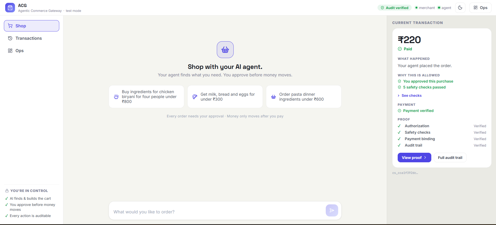
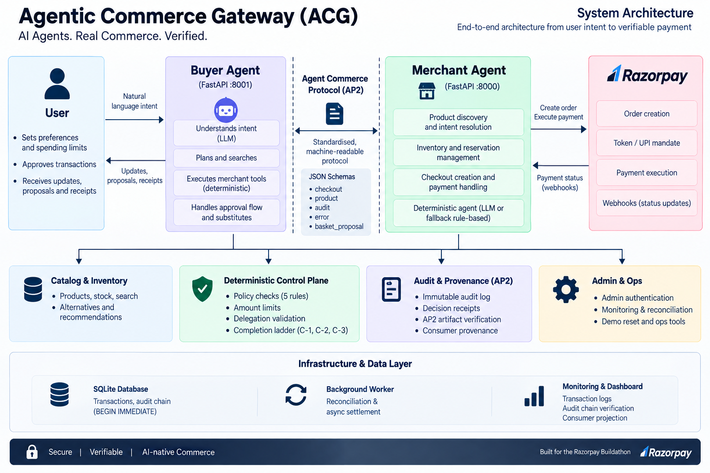
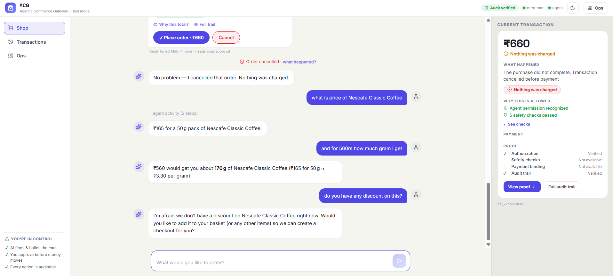
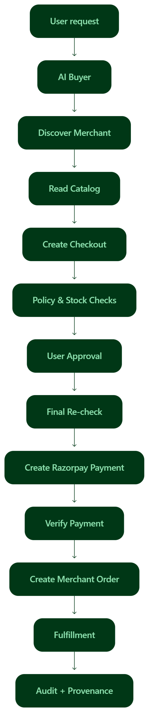
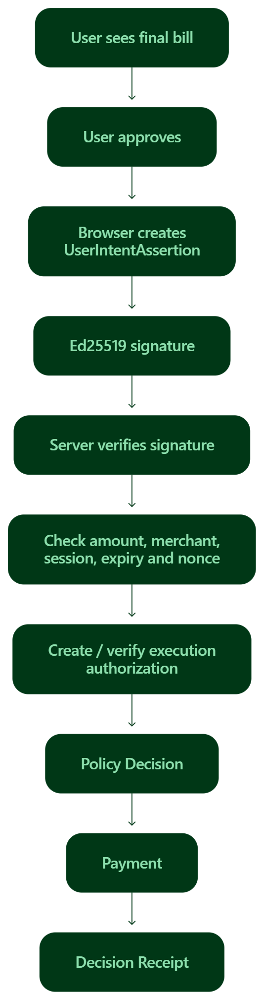
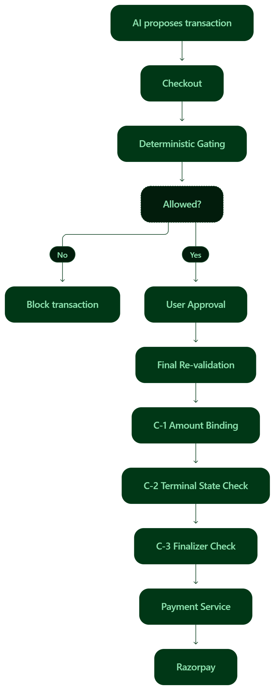
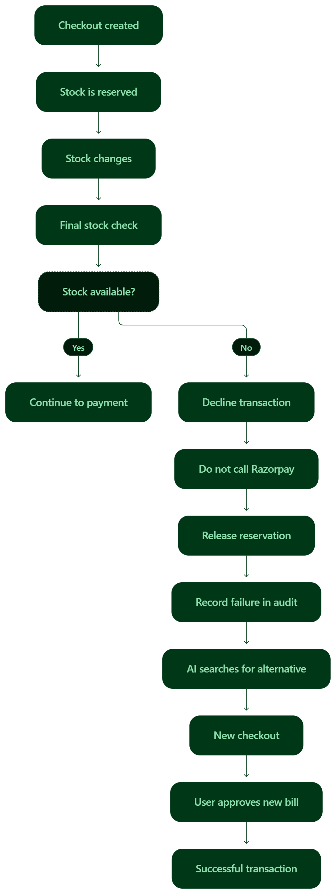

# Agentic Commerce Gateway (ACG)

> **ACG makes a normal merchant ready for AI buyers.**
>
> An AI buyer can discover the merchant, understand its products, create a checkout, get user approval, pay through Razorpay, receive an order, handle failures, and verify what happened — without giving the AI direct control over money.

---

## What is ACG?

Imagine saying:

> **"Buy ingredients for chicken biryani for four people under ₹800."**

Today, an AI can understand this request.

But understanding the request is only the beginning.

The AI still needs to:

1. Find a merchant.
2. Understand what the merchant sells.
3. Check price and stock.
4. Create a proper checkout.
5. Get the user's approval.
6. Make the payment.
7. Create the order.
8. Handle problems.
9. Show what actually happened.

**ACG is the layer that connects all these steps.**

It lets an AI buyer talk to a merchant through a machine-readable protocol and complete a real Razorpay test-mode transaction.

The most important rule is:

> **AI can reason about the transaction.  
> AI cannot directly control the money.**

---

## The problem

AI agents are becoming capable of acting on behalf of people.

That creates two important problems.

### 1. How do we let AI buy something safely?

We should not give an LLM a payment button and trust it with money.

The AI may make a decision, misunderstand something, or produce an unexpected output.

So we need a separate layer that checks whether the transaction is actually allowed.

### 2. How can a new AI buyer use a merchant?

A merchant should not have to know every AI buyer in advance.

A completely new buyer should be able to discover the merchant and understand how to use it without knowing:

- the merchant's source code,
- database,
- internal tools,
- ORM,
- private APIs.

That is the second problem ACG solves.

---

# Our objective

Our goal is simple:

> **Make a merchant genuinely transactable by an AI buyer end to end.**

In ACG, the complete journey is:

```text
Discover
   ↓
Understand
   ↓
Choose
   ↓
Checkout
   ↓
User Approval
   ↓
Safety Checks
   ↓
Payment
   ↓
Order
   ↓
Fulfillment
   ↓
Proof
````

This is more than an AI shopping chatbot.

It is a **transaction layer for AI commerce**.

---

# See it in one example

The user says:

> **"Buy 1 litre of Amul milk."**

ACG turns this simple request into a real transaction:

```text
User
  ↓
AI Buyer
  ↓
Find merchant
  ↓
Check product, price and stock
  ↓
Create checkout
  ↓
User approves
  ↓
Safety checks run again
  ↓
Razorpay payment
  ↓
Merchant creates order
  ↓
Transaction proof is recorded
```

The user sees a simple shopping experience.

Behind it, ACG makes sure every important step is controlled.

> **Intent becomes a real merchant transaction.**

---

## Demo



### What the dashboard shows

The dashboard lets us see both sides of the system:

* the **Shop** experience where the AI buyer talks to the merchant,
* the **Transactions / Money Story** view where the user can understand what happened,
* the **Ops** view where we can inspect rules, payment status, audit events, and agent decisions.

The dashboard is not only for showing the UI.

It is also the proof surface for the transaction.

---

# How ACG works

ACG has three main parts.

```text
┌─────────────────┐
│    AI Buyer     │
│ understands     │
│ user's request  │
└────────┬────────┘
         │
         │ Machine-readable
         │ Commerce Protocol
         ↓
┌─────────────────┐
│ Merchant Agent  │
│ understands     │
│ merchant reality│
└────────┬────────┘
         │
         ↓
┌──────────────────────────┐
│ Deterministic            │
│ Control Plane             │
│                          │
│ Rules • Checkout         │
│ Stock • Order • Payment  │
│ Authorization • Audit    │
└────────────┬─────────────┘
             │
             ↓
          Razorpay
```



### AI Buyer

The AI Buyer represents the user.

It understands what the user wants and communicates with the merchant.

For example:

> "I need ingredients for chicken biryani for four people, under ₹800."

It can reason and negotiate.

But it does not get direct access to Razorpay.

### Merchant Agent

The Merchant Agent represents the merchant.

It understands what the merchant can actually provide.

It can:

* check availability,
* consider alternatives,
* react to changes,
* propose or decline an option.

It also has a deterministic fallback path for important merchant actions, so the workflow does not depend completely on the LLM.

### Commerce Protocol

The protocol is the common language between the buyer and merchant.

It tells a buyer how to:

* discover the merchant,
* understand its capabilities,
* read the catalog,
* create checkout,
* complete a transaction,
* read the order,
* retrieve transaction proof.

### Deterministic Control Plane

This is the most important part for money safety.

> **The AI can suggest. The control plane decides.**

The control plane is normal deterministic program logic.

It checks whether a transaction is allowed before money moves.

### Razorpay

Once all required checks pass, Razorpay executes the payment.

The project uses Razorpay **test mode**, so no real money moves.

### Order and Evidence

After successful payment, the merchant creates the authoritative order.

Important transaction events are also recorded so the transaction can later be explained and verified.

---

# Why the money is safe

ACG separates **AI reasoning** from **money authority**.

The LLM does not directly move money.

Instead, the system uses a **deterministic control plane**.

It checks:

* spending limit,
* allowed category,
* quantity limit,
* delegation expiry,
* current stock,
* approved amount,
* current transaction state.

These checks are not based on whatever text the LLM happens to produce.

They are enforced by application code.


> **AI reasons. Controls decide. Payment executes.**

---

# The merchant owns the price

An AI should not be able to say:

> "The milk costs ₹20."

and expect the merchant to accept that price.

ACG gets the price from the merchant's catalog.

The buyer and agents can request products and quantities, but the merchant is the source of truth for the price.

The final price is checked again during confirmation.

This prevents the AI from changing the amount behind the scenes.



---

# Safety checks happen again before payment

A transaction may have been valid a few seconds ago and become invalid now.

For example:

* stock may disappear,
* a limit may change,
* the transaction may expire,
* the terms may have changed.

So ACG does not blindly trust the earlier checkout.

It performs the important checks again immediately before payment.

This protects against a **time-of-check / time-of-use** problem (TOCTOU).

In simple words:

> **We check again just before money moves.**

---

# C-1, C-2 and C-3

ACG also has three important payment protections.

## C-1 — Amount Binding

The amount approved by the user must match:

```text
User-approved amount
        =
Razorpay order amount
        =
Verified payment amount
```

If these amounts do not match:

> **The payment is stopped.**

No silent change is allowed.

---

## C-2 — Terminal State Protection

Once a transaction reaches a final state such as:

* completed,
* declined,
* cancelled,

it cannot simply become payable again.

This prevents late or stale events from reopening a finished transaction.

---

## C-3 — Finalizer Protection

The final payment step can only run when the transaction is in a valid state.

Calling the final payment step directly from an invalid state is rejected.

These protections make the final money-moving step very difficult to misuse.

---

# Idempotency and replay protection

Sometimes a request can be sent more than once.

That can happen because of:

* network retries,
* duplicate requests,
* delayed callbacks,
* users clicking again.

ACG uses **idempotency** so the same operation can safely be retried without creating another payment or another order.

ACG also protects against replaying old transaction states or approvals.

So:

> **Retrying should not mean paying twice.**

---

# The user is always part of the payment decision

Before money moves, the user approves the final transaction.

That approval becomes a signed authorization called a:

**UserIntentAssertion**

The browser creates this signature using an **Ed25519 key**.

The private key stays on the user's device.

The merchant checks the signature before completing the payment.

In simple words:

> **The user does not just click "Approve".
> The approval becomes a verifiable proof.**

---

# AP2-inspired authorization

ACG uses an **AP2-inspired** authorization flow.

It connects the user request to the final payment:

```text
User Intent
     ↓
Intent Mandate
     ↓
Execution Mandate
     ↓
Policy Decision
     ↓
Payment
     ↓
Decision Receipt
```

The artifacts are signed and cross-bound so that the system can verify how the transaction moved through the flow.

We also provide a standalone verifier that can check the evidence independently.

> **Important:** ACG is AP2-inspired.
> It does not claim full production AP2 compliance.

---

# What happens when something goes wrong?

A good transaction system must also handle failure correctly.

## Example: stock disappears

Suppose the user starts a checkout.

The checkout says the product is available.

Then, before payment, the stock becomes zero.

ACG checks again.

```text
Checkout created
      ↓
Stock changes
      ↓
Final stock check
      ↓
Product unavailable
      ↓
Payment stopped
      ↓
Reservation released
      ↓
AI finds another option
      ↓
New checkout
      ↓
Successful order
```

The important part is:

> **Razorpay is not called for the failed transaction.**

The system does not pretend that payment happened.

The failure is recorded and explained.

---

## Example: request outside the allowed policy

Suppose the user gives the AI a request that is outside the delegated limits.

The AI may understand the request.

But the control plane rejects it.

```text
AI understands request
        ↓
Policy check
        ↓
Not allowed
        ↓
Payment blocked
        ↓
No order
```

The AI cannot override the result.

---

# Why this failure handling matters

A weak system might simply show:

> "Something went wrong."

ACG tries to answer:

* What was requested?
* What was checked?
* What changed?
* Why was the transaction stopped?
* Was Razorpay called?
* Was any money moved?
* Was the reservation released?
* Could the agent recover with another option?

That is the difference between a chatbot error and a controlled commerce failure.

---

# Unknown Buyer

One of the main goals of ACG is that the merchant should not be built only for one special AI client.

So we test a buyer that is treated as a new buyer.

The Unknown Buyer does not use:

* merchant source code,
* merchant database,
* ORM models,
* internal tool names,
* private merchant APIs.

Instead, it uses the published protocol.

The flow is:

```text
Discover merchant
      ↓
Read capabilities
      ↓
Read catalog
      ↓
Create checkout
      ↓
Approve
      ↓
Complete payment
      ↓
Read order
      ↓
Read provenance
```

The final certification passed:

> **3 / 3 Unknown Buyer tests**

and uses zero `merchant.*` imports.

---

# Buyer-B: independent interoperability test

We also built **Buyer-B**.

Buyer-B is a separate deterministic client.

It does not use the merchant's internal code.

It talks to the merchant using the published HTTP/JSON interface.

This is important because it gives us a second proof:

> **The merchant follows the protocol instead of being secretly connected to one buyer implementation.**

The final audit reports:

> **10 / 10 Buyer-B interoperability tests passed.**

---

# Machine-readable merchant discovery

A new buyer first needs to understand:

> "What can this merchant do?"

ACG publishes a machine-readable merchant capability manifest at:

```text
/.well-known/merchant
```

The buyer can use it to learn about the merchant's capabilities and published contract.

The merchant also exposes structured catalog and transaction data through the protocol.

This means the buyer does not have to guess how the merchant works.

---

# Machine-readable catalog

The merchant exposes structured product information.

This includes things such as:

* product,
* pack size,
* quantity,
* sale basis,
* price basis,
* variant,
* availability.

This matters because an AI should not need to read a human webpage and guess what:

> "1 litre"

or

> "one pack"

actually means.

The protocol provides structured commerce information.

---

# Checkout

Once the buyer understands the merchant and selects an option, it creates a checkout session.

The checkout keeps important transaction terms together.

It can include:

* selected items,
* quantity,
* price,
* fulfillment method,
* destination,
* authorization,
* transaction state.

Before payment, those terms are checked again.

---

# Orders

After successful completion, the merchant creates the authoritative order.

The order is tied to the transaction that produced it.

A buyer can then read:

```text
GET /orders
GET /orders/{id}
```

Access is scoped to the buyer and delegation.

A different buyer cannot simply read someone else's order.

---

# Fulfillment

ACG also keeps fulfillment connected to the order.

The current fulfillment flow is:

```text
pending
   ↓
placed
   ↓
packed
   ↓
shipped
   ↓
delivered
```

The transition is controlled.

Invalid state changes are rejected.

Delivery/pickup information selected during checkout is also carried into the order.

This means the transaction does not stop at payment.

---

# Audit trail

ACG keeps a record of important transaction events.

This is the **audit trail**.

The audit log is:

* append-only,
* hash-chained,
* integrity-verifiable,
* safe against concurrent writers.

In simple words:

> **We keep a tamper-evident history of what happened.**

The Ops view uses these facts to show the transaction story.

---

# Provenance

The audit trail tells us what happened over time.

**Provenance** connects the important transaction facts into a readable and verifiable story.

For example:

```text
User request
    ↓
Merchant proposal
    ↓
Policy checks
    ↓
User approval
    ↓
Payment
    ↓
Order
```

The provenance can also be checked independently using the standalone verifier.

So the system does not only say:

> "Payment successful."

It can show the path that produced that result.

---

# Frontend truth

The dashboard should never guess whether a payment happened.

The UI uses the backend transaction state as the source of truth.

For example, the dashboard does not say:

> "You paid"

just because a browser callback event appeared.

It checks the authoritative backend state first.

This matters especially when gateways are slow or a callback arrives late.

The UI should describe what the backend can actually prove.

---

# Payment boundary

Razorpay integration is kept behind a payment boundary.

The LLM does not receive Razorpay credentials.

The LLM also does not get a direct payment tool.

The payment service handles:

* creating the Razorpay payment flow,
* callback verification,
* payment state,
* reconciliation.

This keeps provider-specific payment code separate from the higher-level transaction rules.

---

# Payment mode

The project uses **Razorpay test mode**.

No real money is moved.

The recommended `saved` driver supports a headless payment flow after the first authorization, while the `checkout` driver opens Razorpay Checkout for each order.

Simulated payments are not available as a normal runtime driver.

This is intentional:

> **The demo should show a real payment integration, not a fake "paid" result.**


---

# What happens if payment confirmation is delayed?

A gateway may take time to confirm a payment.

ACG does not assume that silence means success.

The system can keep the transaction in a pending state and use reconciliation to get the authoritative result.

This is important because:

> **Payment state must come from payment truth, not guesswork.**

---

# Merchant Agent without the LLM

The Merchant Agent normally uses an LLM for reasoning.

But important transaction work should not depend completely on the model.

ACG also includes a deterministic fallback brain.

This means the merchant workflow has a safe fallback path for critical actions.

The final audit confirms the fallback architecture remains intact.

---

# Boundaries inside ACG

A simple way to think about responsibility is:

| Question                     | Who answers it?             |
| ---------------------------- | --------------------------- |
| What does the user want?     | AI Buyer                    |
| What can the merchant offer? | Merchant Agent              |
| What is actually allowed?    | Deterministic Control Plane |
| Can money move?              | Deterministic payment path  |
| Who executes the payment?    | Razorpay                    |
| What is the final order?     | Merchant                    |
| What happened?               | Audit + Provenance          |

This separation is one of the main design decisions in ACG.

---

# Demo

The dashboard is designed to show the important parts of the system in one place.

## Happy path

Try:

> **"Buy ingredients for chicken biryani for four people under ₹800."**

Then:

1. Buyer understands the request.
2. Merchant creates a proposal.
3. Checkout is created.
4. Safety checks pass.
5. User approves.
6. Razorpay processes the payment.
7. Merchant creates the order.
8. The transaction appears in the dashboard.

---

## Failure path

Before payment, make one item unavailable from the Ops view.

Then complete the transaction.

ACG should:

1. detect the stock change,
2. stop payment,
3. release the reservation,
4. record the failure,
5. explain the failure,
6. let the agent find a valid alternative,
7. create a new checkout,
8. complete one valid order.

---

## Audit proof

After the transaction, open the Ops / Money Story view.

Show:

* transaction timeline,
* policy decisions,
* payment state,
* order,
* provenance,
* audit verification.

---

# Technical architecture diagrams

The following diagrams explain the deeper implementation.

## 1. Main system architecture

The main system architecture is shown in the **How ACG works** section above (see `assets/ACG-system-architecture.png`).

```text
User
 ↓
AI Buyer
 ↓
Commerce Protocol
 ↓
Merchant Agent
 ↓
Deterministic Control Plane
 ↓
Payment Service
 ↓
Razorpay
```

with Order, Audit, Provenance and fallback paths around the control plane.

---

## 2. End-to-end transaction flow



This should show the full path:

```text
Intent
 → Discovery
 → Catalog
 → Checkout
 → Gating
 → User Approval
 → Revalidation
 → Payment
 → Order
 → Fulfillment
 → Provenance
```

---

## 3. User authorization / AP2-inspired chain



Show:

```text
User Approval
      ↓
UserIntentAssertion
      ↓
Intent Mandate
      ↓
Execution Mandate
      ↓
Policy Decision
      ↓
Payment
      ↓
Decision Receipt
```

---

## 4. Money safety / bounded execution



Show that:

```text
AI proposes
    ↓
Policy checks
    ↓
Checkout state
    ↓
Final revalidation
    ↓
C-1 amount binding
    ↓
Finalizer
    ↓
Razorpay
```

The key idea is:

> **The LLM is never the final money authority.**

---

## 5. Failure and recovery flow



Show:

```text
Checkout
   ↓
Stock disappears
   ↓
Final re-check
   ↓
Decline
   ↓
Release reservation
   ↓
No Razorpay call
   ↓
Find alternative
   ↓
New checkout
   ↓
Successful order
```

---

# Project structure

The important parts of the repository are:

```text
protocol/
  Published merchant contract and JSON schemas

merchant/
  Merchant API and transaction system

merchant/agent/
  Merchant Agent runtime
  LLM brain
  Deterministic fallback
  Agent decision flow

merchant/control/
  Deterministic control plane
  Gating
  Delegation
  Explanations
  Consumer projection

merchant/domain/
  Checkout
  Orders
  Fulfillment
  Catalog
  Reconciliation

merchant/payment/
  Razorpay integration
  Callback verification
  Reconciliation

merchant/ap2/
  AP2-inspired artifacts
  User assertion service
  Standalone verifier

merchant/evidence/
  Audit trail
  Hash chain
  Verification

merchant/persistence/
  SQLite persistence and DTOs

buyer_service/
  AI Buyer / chat backend

buyer_b/
  Independent deterministic protocol client

cert_unknown_buyer/
  Unknown Buyer certification client

dashboard/
  React + Vite frontend

scripts/
  Seed, reset, failure simulation and scenario tools

docs/
  Deeper technical documentation

artifacts/
  Reproducible evidence
```

---

# Quick start

## 1. Create the environment

```powershell
py -m venv .venv
.venv\Scripts\pip install -r requirements.txt
Copy-Item .env.example .env
```

Fill in the required test-mode credentials.

---

## 2. Seed the demo data

```powershell
.venv\Scripts\python -m scripts.seed_catalog
```

---

## 3. Start the merchant

```powershell
.venv\Scripts\python -m uvicorn merchant.main:app --port 8000
```

---

## 4. Start the buyer

```powershell
.venv\Scripts\python -m buyer_service.main
```

---

## 5. Start the dashboard

```powershell
cd dashboard
npm install
npm run dev
```

Open:

```text
http://localhost:5173
```

---

# Environment variables

The main test-mode credentials are:

| Variable              | Purpose                    |
| --------------------- | -------------------------- |
| `LLM_API_KEY`         | Groq API key               |
| `RAZORPAY_KEY_ID`     | Razorpay test-mode key     |
| `RAZORPAY_KEY_SECRET` | Razorpay test-mode secret  |
| `ADMIN_TOKEN`         | Local demo-only Ops access |

Use test-mode credentials only.

Do not commit real secrets.

---

# Testing

The final release was tested across the complete transaction system.

## Final result

```text
Backend tests          340 passed
Frontend tests          26 passed
Frontend build          PASS

Unknown Buyer           PASS
Buyer-B interoperability PASS
Failure recovery        PASS
Money authority         PASS
C-1                     PASS
C-2                     PASS
C-3                     PASS
User authorization      PASS
AP2 evidence            PASS
Audit                   PASS
Provenance              PASS
Order authority         PASS
Fulfillment             PASS
Frontend truth          PASS
Secret sweep            PASS
Architecture regression NONE
```

The full backend suite completed with:

```text
340 passed / 0 failed
```

The frontend suite completed with:

```text
26 passed
```

and the production frontend build succeeded.

---

# What the tests cover

The test suite covers:

* merchant discovery,
* public catalog,
* checkout,
* gating,
* inventory,
* reservations,
* idempotency,
* price-change confirmation,
* TOCTOU protection,
* C-1 amount binding,
* C-2 terminal-state protection,
* C-3 finalizer protection,
* user authorization,
* UserIntentAssertion,
* AP2-inspired artifacts,
* standalone verification,
* audit integrity,
* audit concurrency,
* provenance,
* Unknown Buyer certification,
* Buyer-B interoperability,
* payment settlement,
* reconciliation,
* orders,
* fulfillment,
* fallback behavior,
* frontend payment-state mapping.

---

# Proof that the merchant is really transactable

ACG is not only tested by the main AI Buyer.

We have multiple independent proofs.

### Unknown Buyer

A new buyer can use the published protocol without importing merchant internals.

**Result: PASS**

### Buyer-B

A separate deterministic client can complete the transaction through the protocol.

**Result: PASS**

### Failure recovery

Stock can disappear before payment and the system can safely stop, recover, and complete a new valid order.

**Result: PASS**

### Money safety

The payment path is protected by deterministic gating, C-1, C-2, C-3, idempotency and replay protection.

**Result: PASS**

### Audit and provenance

The transaction can be reconstructed and independently verified.

**Result: PASS**

---

# What is implemented

ACG currently supports:

* merchant discovery,
* machine-readable merchant capabilities,
* machine-readable catalog,
* AI Buyer,
* Merchant Agent,
* deterministic fallback brain,
* deterministic transaction gating,
* checkout,
* user approval,
* signed UserIntentAssertion,
* AP2-inspired artifacts,
* Razorpay test-mode payments,
* payment reconciliation,
* authoritative orders,
* fulfillment state,
* failure recovery,
* Unknown Buyer certification,
* Buyer-B interoperability,
* append-only audit,
* hash-chained audit verification,
* consumer provenance,
* standalone evidence verification.

---

# What is intentionally out of scope

ACG is a reference implementation focused on proving the core idea.

It is not trying to solve every production commerce problem.

It intentionally does not provide:

* full ACP compliance,
* full AP2 production compliance,
* production KYC / identity infrastructure,
* universal payment-provider support,
* production-scale infrastructure,
* a complete logistics platform,
* refunds,
* returns,
* reorders.

The current fulfillment support covers delivery/pickup selection and address binding, not a complete logistics network.

---

# Security and trust notes

All payment amounts shown in the demo are Razorpay **test-mode** amounts.

No real money moves.

Real credentials are kept outside the repository.

The merchant signing private key is stored locally in a gitignored location.

The repository contains the public verification key needed for the standalone verification flow.

The final release audit found:

> **No accidental credentials committed to the repository or its history.**

---

# Why ACG matters

AI commerce is not only about making an AI understand shopping.

The harder problem is making the **merchant itself ready for AI**.

A real AI buyer needs more than a chatbot.

It needs:

```text
Discovery
   +
Commerce protocol
   +
Checkout
   +
User approval
   +
Money controls
   +
Payment
   +
Order
   +
Failure recovery
   +
Proof
```

ACG brings these pieces together.

The AI can reason.

The merchant can respond.

The user stays in control.

The money stays bounded.

And the transaction leaves proof.

---

# In one sentence

> **ACG is a machine-readable, safety-controlled transaction layer that lets independent AI buyers purchase from ordinary merchants without giving the AI direct control over money.**

---

# Go deeper

This README is meant to explain the project quickly.

For technical details, see:

* **Protocol specification** — `protocol/protocol_spec.md`
* **JSON schemas** — `protocol/schemas/`
* **Consumer provenance** — `docs/CONSUMER_PROVENANCE.md`
* **Standalone AP2-inspired verifier** — `docs/AP2_STANDALONE_VERIFIER.md`
* **Reproducible evidence** — `artifacts/`
* **Technical architecture** — `docs/TECHNICAL.md`

---

# Final message

ACG is built around one simple idea:

> **An AI should be able to shop for a user without becoming the owner of the user's money.**

So:

**AI reasons.**

**The protocol connects.**

**The control plane decides.**

**The user approves.**

**Razorpay executes.**

**The merchant creates the order.**

**The system records the proof.**