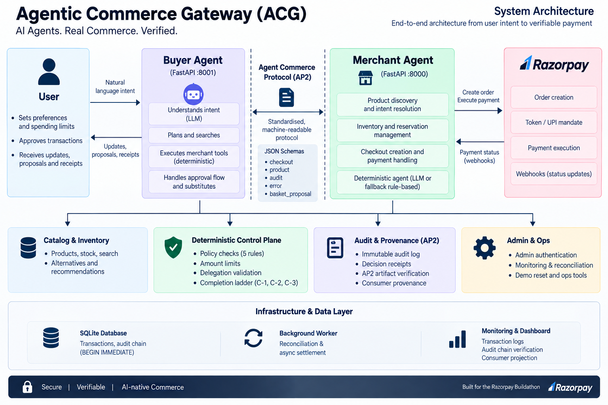
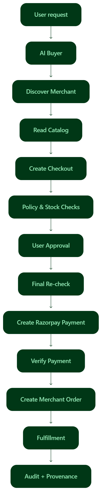
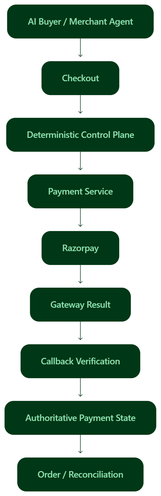

# ACG Technical Architecture & Implementation

> This document explains how the Agentic Commerce Gateway (ACG) works internally.
>
> The main `README.md` explains **what ACG is and why it matters**.
>
> This document explains **how ACG is built and how its guarantees are enforced**.

---

# 1. Technical overview

ACG is built to let an independent AI buyer complete a merchant transaction from start to finish.

The important design decision is that **AI reasoning and money authority are kept separate**.

The AI can:

- understand the user's request,
- discover products,
- negotiate,
- suggest alternatives,
- react to changes.

But the AI cannot directly:

- decide whether money is allowed to move,
- create arbitrary payment amounts,
- bypass policy,
- call Razorpay directly,
- reopen a completed transaction.

Those responsibilities belong to deterministic application code.

The simplest way to describe the design is:

```text
AI reasons
    ↓
Protocol connects
    ↓
Control plane checks
    ↓
User approves
    ↓
Control plane checks again
    ↓
Payment executes
    ↓
Merchant creates order
    ↓
Evidence is recorded
````

The final release audit verified this separation and found no architecture regression.  

---

# 2. Main architecture



At a high level, ACG has these major parts:

```text
┌──────────────────────┐
│       User           │
│                      │
│ "Buy 1L Amul milk"   │
└──────────┬───────────┘
           │
           ↓
┌──────────────────────┐
│      AI Buyer        │
│                      │
│ Understands intent   │
│ Negotiates options   │
└──────────┬───────────┘
           │
           │ Commerce Protocol
           ↓
┌──────────────────────┐
│   Merchant Agent     │
│                      │
│ Understands merchant │
│ reality + options    │
└──────────┬───────────┘
           │
           ↓
┌─────────────────────────────────────┐
│      Deterministic Control Plane    │
│                                     │
│ Policy      Checkout     Inventory  │
│ State       Authorization   Payment │
│ Order       Idempotency    Evidence │
└──────────────┬──────────────────────┘
               │
               ↓
          ┌──────────┐
          │ Razorpay │
          └──────────┘
```

The control plane is the trusted execution boundary.

LLMs operate above it.

Money-moving code operates below it.

---

# 3. Component responsibilities

ACG intentionally separates responsibilities.

| Component                   | Main job                                                          |
| --------------------------- | ----------------------------------------------------------------- |
| AI Buyer                    | Understands the user's request and communicates with the merchant |
| Merchant Agent              | Reasons about what the merchant can provide                       |
| Commerce Protocol           | Defines how buyers and merchants communicate                      |
| Deterministic Control Plane | Decides what is allowed                                           |
| Payment Service             | Creates and verifies payment operations                           |
| Razorpay                    | Executes the payment                                              |
| Order Service               | Creates the authoritative merchant order                          |
| Audit Service               | Records important transaction events                              |
| Provenance Service          | Builds a verifiable transaction story                             |
| Dashboard                   | Shows the transaction and operational evidence                    |

This separation is important because a single component should not be allowed to both **reason about a decision** and **have unrestricted authority to execute that decision**.

---

# 4. Service layout

ACG currently has three main runtime services.

| Service          | Purpose                                | Technology       |
| ---------------- | -------------------------------------- | ---------------- |
| `buyer_service/` | AI Buyer / chat backend                | Python + Groq    |
| `merchant/`      | Merchant API and transaction authority | FastAPI + SQLite |
| `dashboard/`     | User and Ops dashboard                 | React + Vite     |

There are also independent protocol clients:

```text
buyer_b/
    Independent deterministic buyer

cert_unknown_buyer/
    Machine-checkable Unknown Buyer certification client
```

The merchant itself does not depend on either implementation.

---

# 5. The commerce protocol

The protocol is the common language between the buyer and merchant.

The goal is simple:

> A new buyer should be able to use the merchant without knowing the merchant's internal implementation.

The protocol therefore exposes structured interfaces for:

```text
Merchant discovery
       ↓
Capabilities
       ↓
Catalog
       ↓
Discovery
       ↓
Checkout
       ↓
Completion
       ↓
Orders
       ↓
Provenance
```

The published contract lives in:

```text
protocol/protocol_spec.md
protocol/schemas/
```

The schemas define the expected shape of important messages.

This is important because AI buyers should work from a **contract**, not from assumptions about a specific codebase.

---

# 6. Merchant discovery

A new buyer first needs to know:

> "What is this merchant and what can I do with it?"

ACG exposes a machine-readable capability manifest:

```text
/.well-known/merchant
```

This gives a buyer a standard starting point for understanding the merchant.

The buyer can then use the published protocol instead of inspecting merchant code.

This is one of the foundations of Unknown Buyer interoperability.

---

# 7. Machine-readable catalog

The merchant also exposes structured catalog information.

The buyer should not have to guess the meaning of:

> "1 litre"

or:

> "one pack"

from a human-facing webpage.

The catalog contains explicit commerce information such as:

* product,
* quantity,
* pack size,
* sale basis,
* price basis,
* variant,
* availability.

A buyer can use these structured values directly.

The merchant remains the source of truth for pricing.

---

# 8. End-to-end transaction flow



The complete transaction has several stages.

```text
1. User intent
        ↓
2. Merchant discovery
        ↓
3. Catalog / product understanding
        ↓
4. Proposal
        ↓
5. Checkout creation
        ↓
6. Policy checks
        ↓
7. User approval
        ↓
8. Final revalidation
        ↓
9. Razorpay payment
        ↓
10. Verified result
        ↓
11. Order creation
        ↓
12. Fulfillment
        ↓
13. Provenance / audit
```

Each stage has a different responsibility.

---

# 9. Stage 1 — User intent

The user starts with a natural-language request.

For example:

```text
"Buy ingredients for chicken biryani for four people under ₹800."
```

The AI Buyer turns this into a structured shopping task.

The AI is responsible for understanding the request.

It is **not** responsible for deciding whether the payment is allowed.

---

# 10. Stage 2 — Merchant discovery

The AI Buyer discovers the merchant through the published protocol.

It can learn:

* merchant capabilities,
* supported operations,
* commerce rules,
* available catalog information.

The discovery process is independent of the merchant's internal database or Python modules.

---

# 11. Stage 3 — Product and catalog understanding

The buyer requests structured product information.

This is where the system establishes the actual:

* product,
* quantity,
* pack,
* price,
* stock,
* variant.

The important design rule is:

> **The buyer can request products and quantities, but it cannot become the source of truth for price.**

---

# 12. Stage 4 — Proposal

The buyer and Merchant Agent can negotiate a possible purchase.

For example:

```text
User:
"Buy biryani ingredients for four people under ₹800."

Buyer:
Find suitable items.

Merchant Agent:
Creates a valid proposal.

Buyer:
Reviews the proposal.

User:
Approves the final bill.
```

The proposal is not yet the payment.

The proposal becomes a transaction only after it passes checkout and authorization controls.

---

# 13. Stage 5 — Checkout creation

The merchant creates a checkout session.

The checkout captures the important transaction terms.

Depending on the selected flow, these can include:

* products,
* quantity,
* price,
* fulfillment method,
* destination,
* delegation,
* transaction state.

At this point, deterministic gating runs.

---

# 14. Deterministic control plane

The deterministic control plane is the heart of ACG's safety model.

It is the part that answers:

> **"Are we actually allowed to do this?"**

It contains the important deterministic controls around:

* policy,
* checkout,
* inventory,
* reservations,
* payment,
* orders,
* authorization,
* evidence.

The LLM cannot override its result.

The final audit confirmed that all major gating rules run at checkout creation and again during completion. 

---

# 15. Policy gating

The gating layer checks the transaction against the user's delegated limits.

The important checks include:

```text
Spend limit
Category allow-list
Quantity limit
Delegation expiry
Stock availability
Transaction state
```

These are deterministic checks.

The LLM can propose an action.

The gate decides whether that action is allowed.

---

# 16. Gating happens more than once

One important detail is that a transaction is not trusted forever after its first successful check.

A transaction can become invalid later.

For example:

```text
10:00 — stock = 5
10:01 — checkout created
10:02 — stock = 0
10:03 — payment requested
```

A naive system could still try to pay.

ACG does not.

It checks again immediately before payment.

This protects against a classic **TOCTOU** problem:

> Time Of Check → Time Of Use

In simple language:

> **Something can change after we check it, so we check again before money moves.**

---

# 17. Server-authoritative pricing

Price comes from the merchant.

The AI does not submit the final payment amount as trusted input.

Instead:

```text
Buyer request
     ↓
Merchant catalog
     ↓
Merchant price
     ↓
Checkout terms
     ↓
Final confirmation
```

This prevents the AI from silently changing:

```text
₹629
```

into:

```text
₹1,629
```

or inventing a price that the merchant never offered.

---

# 18. Reservation model

Checkout can reserve inventory.

This gives the system a temporary claim on the selected stock while the transaction is in progress.

If the transaction fails before payment, the reservation is released.

For example:

```text
Checkout created
       ↓
Reservation created
       ↓
Payment fails / becomes invalid
       ↓
Reservation released
```

This is especially important in the stock-out recovery flow.

The final end-to-end failure test confirmed that failed reservations were released and no active reservation remained. 

---

# 19. User authorization

The user is part of the money decision.

The final transaction must be explicitly approved.

At approval time, the browser creates a signed:

```text
UserIntentAssertion
```

This is a cryptographic record of the user's authorization.

The private signing key stays in the browser.

The server verifies the resulting signature and its transaction bindings.

---

# 20. UserIntentAssertion

The assertion is linked to important transaction facts.

The server checks things such as:

* signature,
* assertion integrity,
* merchant binding,
* checkout/session binding,
* amount ceiling,
* delegation,
* expiry/freshness,
* nonce / single-use behavior.

This prevents an old or unrelated user approval from being reused for a different transaction.

The final audit reports browser-side Ed25519 signing, server verification, freshness, binding, ceiling, expiry and nonce checks as PASS. 

---

# 21. Ed25519

ACG uses **Ed25519** for the user assertion signature.

The basic flow is:

```text
User approves
      ↓
Browser creates signature
      ↓
Private key stays in browser
      ↓
Signed assertion sent to server
      ↓
Server verifies signature
      ↓
Transaction may continue
```

The server never needs the user's private key.

It only needs the information required to verify the signature.

---

# 22. AP2-inspired authorization chain

ACG uses an **AP2-inspired** transaction evidence chain.

The chain connects:

```text
User Assertion
      ↓
Intent Mandate
      ↓
Execution Mandate
      ↓
Policy Decision
      ↓
Payment
      ↓
Decision Receipt
```

The purpose is to keep the important decisions connected.

The artifacts are signed and cross-bound so that later verification can establish how the transaction progressed.

ACG also includes a standalone verifier.

Important:

> **ACG does not claim full production AP2 compliance.**
>
> The implementation is AP2-inspired and is documented that way.

The final release audit explicitly confirms this wording. 

---

# 23. Final revalidation ladder

After user approval, the system still does not immediately trust the transaction.

The completion flow performs deterministic checks before the irreversible payment operation.

Conceptually:

```text
User authorization
       ↓
Current checkout state
       ↓
Current policy
       ↓
Current stock
       ↓
Amount binding
       ↓
Create / verify payment
       ↓
Final result
```

The exact implementation is distributed across the checkout and payment domain, but the key idea is:

> **Every important assumption is checked again before the irreversible step.**

---

# 24. C-1 — Amount binding

C-1 is the rule that prevents amount drift.

The three important values must agree:

```text
User-approved amount
        =
Razorpay order amount
        =
Verified payment amount
```

If they differ:

```text
Transaction → DECLINED
Payment      → BLOCKED
Order        → NOT CREATED
```

The final audit verified:

* matching amounts succeed,
* mismatched amounts fail closed,
* divergent payment paths do not create a valid order. 

---

# 25. C-2 — Terminal-state protection

A transaction can reach a final state such as:

```text
completed
declined
cancelled
```

Once it is terminal, it must not reopen because of a stale or late event.

For example:

```text
completed
    ↓
late callback arrives
    ↓
REJECT
```

The callback cannot move the transaction backward into a payable state.

The final audit confirmed that late/stale callbacks against terminal sessions are rejected and the state does not reopen. 

---

# 26. C-3 — Finalizer protection

The finalizer is the last step that can perform the important financial state transition.

C-3 makes sure that the finalizer can only run from an allowed transaction state.

For example:

```text
valid checkout
     ↓
finalizer
     ↓
payment transition
```

but:

```text
already completed
     ↓
finalizer
     ↓
REJECT
```

Calling the finalizer from an invalid state does not mutate the transaction.

The final audit verified this behavior directly. 

---

# 27. Idempotency

Payment operations can be retried.

For example, a client might send the same request twice because it did not receive the first response.

Without protection:

```text
Request 1 → payment
Request 2 → another payment
```

ACG instead uses idempotency.

Conceptually:

```text
Request + Idempotency-Key
          ↓
Stored result
          ↓
Retry
          ↓
Return same result
```

This means retrying the same operation does not accidentally create another charge or another order.

The final audit verified snapshot replay and at-most-one order behavior. 

---

# 28. Replay protection

Idempotency is not the only replay protection.

ACG also protects against:

* terminal-state replay,
* stale confirmation state,
* old mandates,
* reused authorization nonce,
* silent price changes.

For example:

```text
Old approval
     ↓
Different transaction
     ↓
REJECT
```

A price change can also move the transaction back into a confirmation-required state instead of allowing payment to continue silently.

The final audit verified replay protection and confirmation-staleness behavior. 

---

# 29. Payment architecture



The payment system is deliberately separated from the agent layer.

Conceptually:

```text
AI / Agent
    │
    │  No direct Razorpay access
    ↓
Checkout / Control Plane
    ↓
Payment Service
    ↓
Razorpay
    ↓
Callback / verification
    ↓
Authoritative payment state
```

The LLM does not receive:

* Razorpay credentials,
* a direct payment tool,
* unrestricted access to the payment service.

The final audit confirms Razorpay access is confined to the payment layer and callback path.  

---

# 30. Razorpay integration boundary

Razorpay-specific code lives behind the payment boundary.

The higher-level transaction logic works with payment concepts such as:

```text
create payment
check payment
verify callback
reconcile payment
```

rather than spreading Razorpay-specific behavior through the entire merchant domain.

This gives ACG a cleaner separation between:

```text
Commerce logic
      ↓
Payment semantics
      ↓
Razorpay adapter
```

The final audit confirms the payment domain remains provider-neutral in its higher-level semantics. 

---

# 31. Callback verification

A gateway callback is not treated as unquestionable truth.

The backend checks the authoritative payment state before committing the final transaction state.

This protects the system from:

* stale callbacks,
* duplicate callbacks,
* callbacks arriving after the transaction is already terminal,
* inconsistent client-side assumptions.

The frontend also does not treat a browser callback by itself as proof that payment succeeded.

---

# 32. Reconciliation

Payment confirmation can sometimes be delayed.

ACG therefore supports a reconciliation path.

Conceptually:

```text
Payment started
      ↓
Result not final yet
      ↓
payment_pending
      ↓
Reconciliation
      ↓
Authoritative payment result
```

The reconciliation path does not create arbitrary new charges.

It exists to recover the correct payment state.

The final audit confirmed the presence of payment-pending and reconciliation behavior and that the reconciliation path does not initiate charges. 

---

# 33. Order authority

After successful payment, the merchant creates the authoritative order.

The AI does not become the source of truth for the order.

The order is tied to the completed transaction and its important terms.

The implementation also protects against creating multiple authoritative orders from the same transaction.

The final audit confirmed:

* at-most-one order behavior,
* ownership checks,
* transaction binding,
* amount binding. 

---

# 34. Order ownership

Orders are scoped to the buyer and delegation.

A buyer should not be able to simply request another buyer's order.

Conceptually:

```text
Buyer A
   ↓
GET /orders
   ↓
Only Buyer A's allowed orders
```

A cross-buyer access attempt is rejected.

---

# 35. Fulfillment

ACG keeps fulfillment connected to the transaction.

The current fulfillment state machine is:

```text
pending
   ↓
placed
   ↓
packed
   ↓
shipped
   ↓
delivered
```

Transitions are validated.

An invalid transition is rejected.

For example:

```text
pending → shipped
```

is not the same as:

```text
pending → placed → packed → shipped
```

The final audit confirms the state machine and illegal-transition protection. 

---

# 36. Fulfillment binding

Fulfillment terms selected during checkout are carried into the authoritative order.

Examples include:

```text
delivery
pickup
destination / address
```

The important rule is:

> **The order should represent what the user actually approved at checkout.**

Checkout fulfillment terms are therefore pinned and copied into the final order.

The final audit explicitly verified that checkout and order fulfillment terms match. 

---

# 37. Failure handling

A transaction system should treat failure as a normal path, not as an exception nobody understands.

ACG's failure design follows this pattern:

```text
Detect
  ↓
Explain
  ↓
Stop unsafe action
  ↓
Release temporary resources
  ↓
Record evidence
  ↓
Recover when possible
```

The system should never continue blindly after an important condition becomes invalid.

---

# 38. Stock-out failure

The main demonstrated failure path is:

```text
Checkout created
      ↓
Stock disappears
      ↓
Final stock check
      ↓
STOCK_UNAVAILABLE
      ↓
Payment blocked
      ↓
Reservation released
      ↓
No Razorpay call
      ↓
Agent searches for alternative
      ↓
New checkout
      ↓
Successful new order
```

The final audit ran this as an end-to-end recovery harness.

It verified:

* structured stock error,
* no Razorpay order,
* no payment object,
* released reservation,
* failure audit evidence,
* alternative product discovery,
* one successful replacement order,
* valid provenance. 

---

# 39. Policy failure

Another failure path is a request outside the user's allowed policy.

For example:

```text
Requested amount
      ↓
Spend limit check
      ↓
Over limit
      ↓
PAYMENT_BLOCKED
```

The AI may understand the request.

The control plane still rejects it.

There is no payment and no order.

This is a central example of the separation:

> **Understanding a request does not mean being allowed to execute it.**

---

# 40. Merchant Agent architecture

The Merchant Agent has two important layers:

```text
Merchant Agent
       │
       ├── LLM brain
       │
       └── Deterministic fallback brain
```

The LLM provides reasoning and adaptation.

The deterministic fallback provides a predictable path for important merchant actions.

This prevents the system from making the entire transaction workflow dependent on an LLM being available and behaving correctly.

The final audit confirms the deterministic fallback remains intact. 

---

# 41. LLM boundary

The LLM is used for reasoning.

The LLM can help answer questions such as:

```text
What does the user want?
What products fit the request?
What alternatives could work?
How should the merchant respond?
```

But it cannot answer authoritative money questions such as:

```text
Can I bypass the spend limit?
Can I change the final payment amount?
Can I reopen a completed transaction?
Can I directly call Razorpay?
```

Those decisions belong to deterministic application logic.

---

# 42. Deterministic fallback brain

The fallback brain provides a non-LLM path for bounded merchant behavior.

This is useful for two reasons:

1. Safety — critical rules do not depend on model output.
2. Reliability — important workflow behavior can continue even when the LLM is unavailable.

The fallback is still subject to the same control-plane rules.

It does not become a second uncontrolled payment authority.

---

# 43. Merchant Agent tool boundary

The Merchant Agent uses an allowlisted tool registry.

The tool layer determines what the agent is allowed to call.

This creates another boundary between:

```text
Agent reasoning
      ↓
Allowed tool invocation
      ↓
Deterministic business logic
```

A tool returning a result does not automatically mean the action is approved.

The final decision still belongs to the appropriate deterministic service.

---

# 44. Unknown Buyer architecture

The Unknown Buyer is deliberately implemented outside the merchant application logic.

Its job is to ask:

> **"Can a buyer that knows only the published protocol actually use this merchant?"**

The certification client uses:

```text
stdlib + httpx + protocol schemas
```

and does not import:

```text
merchant.*
```

The final audit confirmed this with structural inspection. 

---

# 45. Unknown Buyer flow

The certification flow is:

```text
/.well-known/merchant
          ↓
/discover
          ↓
/catalog/packs/{id}
          ↓
/checkout_sessions
          ↓
/complete
          ↓
/orders
          ↓
/orders/{id}
          ↓
/provenance/{id}
```

The client uses the published contract to understand what each response means.

It does not inspect the merchant database or application internals.

The final release audit reported:

```text
Unknown Buyer certification
3 passed / 3 total
```

with zero merchant imports. 

---

# 46. Buyer-B interoperability

Buyer-B is another independent client.

Its purpose is different from the main AI Buyer and different from the Unknown Buyer certification code.

Buyer-B uses:

```text
HTTP
JSON
Published protocol
```

rather than merchant internals.

This lets us test whether the protocol really acts as a boundary.

The final audit verified:

```text
Buyer-B interoperability
10 passed / 10 total
```

including connection-failure handling and a complete live transaction flow. 

---

# 47. Why Buyer-B matters

Without an independent client, it is easy to accidentally build a system where:

```text
Buyer A
   ↕
Special internal knowledge
   ↕
Merchant
```

That can look like interoperability while actually being tightly coupled.

Buyer-B tests a different path:

```text
Independent Buyer
       ↓
Published Protocol
       ↓
Merchant
```

That is much stronger evidence that the protocol is real.

---

# 48. Audit trail

ACG keeps an append-only audit trail.

Important events are recorded in order.

The audit service uses:

```text
SHA-256 hash chain
+
signed head anchor
+
concurrency-safe writes
```

In simple terms:

> **Each event is linked to the previous event, making the history tamper-evident.**

The audit history is not treated like a normal disposable log.

The final audit confirmed:

* centralized append-only writes,
* SHA-256 chain,
* signed anchor,
* concurrency protection,
* reset semantics that preserve audit rows. 

---

# 49. Why an audit chain is useful

A normal log can tell us:

```text
Payment completed
```

An audit chain can help us answer:

```text
What happened before it?
What was checked?
What was approved?
What decision was made?
What happened at payment?
What order was created?
```

It provides a structured history rather than only a final status.

---

# 50. Provenance

Provenance is the transaction story.

It connects the important facts of the transaction:

```text
User request
     ↓
Merchant response
     ↓
Policy decision
     ↓
User authorization
     ↓
Payment
     ↓
Order
```

The consumer-facing provenance is designed to explain what happened without exposing unnecessary internal implementation details.

---

# 51. Standalone verification

ACG also provides a standalone verifier.

The important property is:

> **Verification does not need to trust the live merchant process.**

The verifier can use the provided evidence and public verification material.

It does not need:

* merchant database access,
* merchant private key,
* merchant application internals.

The final audit reports the offline verification result as:

```text
VALID
```

and confirms the verifier does not load the merchant private key. 

---

# 52. Consumer provenance vs technical evidence

ACG keeps two related views.

### Consumer view

The user should see:

```text
What happened?
Why did it happen?
Did money move?
What order was created?
```

### Technical view

An engineer or judge can inspect:

```text
Policy decisions
Payment state
Audit events
Authorization artifacts
Hashes
Verification evidence
Agent trace
```

The dashboard deliberately separates these levels so that transparency does not require showing every internal implementation detail.

---

# 53. Frontend truth model

The frontend does not invent transaction state.

It uses the backend's authoritative checkout status.

There is a single frontend mapping for payment state.

Conceptually:

```text
Backend status
      ↓
Payment-state mapping
      ↓
UI state
```

The UI does not say:

> "You paid"

only because it saw a browser callback event.

Instead, it checks the authoritative backend state.

This prevents stale or misleading payment messages.

The final audit confirmed this behavior and reported 26 frontend mapping tests passed. 

---

# 54. Why backend truth matters

Payment gateways can be delayed.

Callbacks can arrive late.

Requests can be retried.

The browser can disconnect.

Therefore:

```text
Browser event
      ≠
Authoritative payment truth
```

The frontend should display what the backend has actually verified.

This is especially important for statements such as:

```text
Paid
Nothing charged
Payment pending
Payment declined
```

Those messages must be evidence-based.

---

# 55. Persistence and state

ACG uses SQLite for durable transaction state.

The important durable entities include:

```text
Checkout
Order
Inventory
Reservation
Payment state
Delegation
Audit events
Authorization artifacts
```

The system distinguishes between:

```text
Durable transaction truth
```

and:

```text
Temporary UI / agent state
```

The transaction and order should not depend only on what happens to be in an LLM conversation.

---

# 56. Transaction state machine

A checkout progresses through controlled states.

A simplified view is:

```text
created
   ↓
updated / confirmed
   ↓
ready for completion
   ↓
payment processing
   ↓
completed
```

Failure paths can produce:

```text
declined
cancelled
payment_pending
```

Once a session becomes terminal, protections stop stale operations from reopening it.

This state machine is one of the foundations of C-2 and C-3.

---

# 57. Delegation

A buyer does not receive unlimited authority.

Delegation information can contain constraints such as:

```text
Spend ceiling
Allowed category
Quantity limit
Expiry
Buyer identity
```

The control plane checks those limits when deciding whether the transaction is allowed.

This is how ACG keeps the buyer's authority bounded.

The final audit specifically verifies spend, quantity, category and expiry checks. 

---

# 58. Bounded autonomy

The Merchant Agent is allowed to reason and adapt, but that autonomy is bounded.

For example, the agent can:

```text
Find another product
```

but it cannot use that autonomy to:

```text
Ignore spend limits
Change user-approved amount
Bypass authorization
Call payment directly
```

This creates an important boundary:

> **Autonomy is allowed inside the rules, not instead of the rules.**

---

# 59. Substitution safety

A merchant agent may need to suggest an alternative when inventory changes.

However, substitution must not become a silent modification of what the user approved.

ACG therefore treats changed terms carefully.

A changed product or price can require new confirmation instead of silently continuing the old approval.

The final audit confirms the presence of substitution/modification guards and price-change confirmation behavior.  

---

# 60. Failure and recovery as a single transaction story

The system should preserve the difference between:

```text
Failed transaction
```

and:

```text
Successful replacement transaction
```

For example:

```text
Transaction A
   ↓
Stock failure
   ↓
No payment
   ↓
Reservation released

Transaction B
   ↓
New user-approved terms
   ↓
Payment
   ↓
Order
```

These should never be merged into a misleading single "successful" transaction.

The final failure/recovery harness verifies exactly this separation. 

---

# 61. Error model

The protocol uses structured errors rather than returning vague failures.

For example:

```text
STOCK_UNAVAILABLE
PAYMENT_BLOCKED
INVALID_STATE_TRANSITION
```

A structured error gives the buyer or agent something useful to act on.

For example:

```text
STOCK_UNAVAILABLE
       ↓
Search catalog again
       ↓
Find another valid product
```

instead of:

```text
Something went wrong.
```

The final audit also verified that protocol error definitions and runtime error codes remain aligned. 

---

# 62. Payment status model

The frontend and backend distinguish different payment states.

Conceptually:

```text
NOT_ATTEMPTED
      ↓
ORDER_CREATED
      ↓
PENDING
      ↓
VERIFIED
```

with failure paths such as:

```text
DECLINED
BLOCKED
UNAVAILABLE
UNKNOWN
```

The key rule is:

> **Do not claim success unless the backend has evidence of success.**

The final frontend truth audit confirms that payment explanations are gated by authoritative backend proof. 

---

# 63. Payment driver design

ACG currently supports real Razorpay test-mode payment drivers.

## `saved`

After the first eligible authorization flow, later payments can use a stored Razorpay mandate/token path.

This provides a headless payment experience.

## `checkout`

Razorpay Checkout is opened for each payment.

Both are real Razorpay test-mode paths.

Simulated payment is not a normal runtime driver.

The final audit confirms simulation is hard-rejected outside explicit test execution. 

---

# 64. Why simulated payments were removed from runtime

A fake payment result can make a demo look successful even when the real integration is broken.

ACG deliberately avoids that.

The runtime should either:

```text
Use the real Razorpay test-mode integration
```

or:

```text
Fail
```

It should not silently pretend that money moved.

This makes the demo evidence much stronger.

---

# 65. Secret boundaries

Razorpay and LLM credentials are not exposed to the LLM.

The important secret boundary is:

```text
Environment / secret storage
           ↓
Payment service / provider client
```

not:

```text
LLM
   ↓
Payment credentials
```

The user-facing dashboard also does not ship the payment secret.

The final audit performed a repository and history secret sweep and found no accidental credentials. 

---

# 66. Merchant signing key

The merchant uses signing material for verification-related workflows.

The private key remains local and gitignored.

The public verification key can be distributed for independent verification.

Conceptually:

```text
Private key
    ↓
Signing
    ↓
Evidence

Public key
    ↓
Verification
```

This is why verification does not require exposing the private key.

---

# 67. Why the control plane is deterministic

A deterministic control plane is useful because the same input should produce the same policy result.

For example:

```text
Spend = ₹500
Limit = ₹300
```

should always produce:

```text
REJECT
```

It should not depend on:

* model temperature,
* wording,
* prompt interpretation,
* previous conversation,
* LLM confidence.

That makes the money boundary predictable and testable.

---

# 68. Why LLM reasoning remains useful

Separating authority from reasoning does not mean removing AI.

The AI is still useful for:

* understanding natural language,
* resolving user intent,
* finding options,
* handling ambiguity,
* negotiating,
* adapting to inventory changes.

The design is not:

```text
No AI
```

It is:

```text
AI for reasoning
+
Deterministic code for authority
```

That is the central architecture decision of ACG.

---

# 69. Unknown Buyer certification design

The Unknown Buyer test acts as a protocol-level certification.

Its job is not to test every internal function.

Its job is to test:

> **Can an external buyer use the merchant using only the published contract?**

The test therefore intentionally avoids:

```text
merchant imports
database access
ORM access
internal tool calls
private implementation knowledge
```

Instead it consumes:

```text
manifest
schemas
HTTP endpoints
JSON responses
```

The final audit confirms this structure. 

---

# 70. Buyer-B test design

Buyer-B is intentionally separate from the main buyer implementation.

The audit checked for:

```text
No merchant imports
No buyer_service imports
No shared implementation with certification client
```

It communicates using HTTP/JSON.

This is useful because it provides a second independent proof of protocol interoperability.

The final audit reports 10/10 interop tests passed. 

---

# 71. Test strategy

ACG has several levels of verification.

## Unit tests

Check small pieces of logic.

Examples:

```text
gating
amount binding
state transitions
idempotency
authorization
schema behavior
```

## Integration tests

Check multiple services and flows together.

Examples:

```text
checkout → payment → order
stock failure → recovery
callback handling
reconciliation
```

## Protocol certification

Checks:

```text
Unknown Buyer
Buyer-B
```

## Frontend tests

Check:

```text
payment state mapping
```

## Runtime scenario checks

Run end-to-end adversarial flows.

The final release audit reports all these categories as passing. 

---

# 72. Important verified test areas

The final audit reports coverage for:

```text
Checkout
Orders
Fulfillment
Gating
Idempotency
TOCTOU
TTL
Price-change confirmation
C-1
C-2
C-3
UserIntentAssertion
AP2-inspired verification
Provenance
Audit integrity
Audit concurrency
Unknown Buyer
Buyer-B
Inventory
Reservations
Settlement
Reconciliation
Merchant Agent loop
Fallback behavior
Frontend payment truth
```

The full backend test suite completed with:

```text
340 passed
0 failed
```

The frontend completed with:

```text
26 passed
```

and the frontend production build succeeded. 

---

# 73. Final claim → implementation mapping

The main product claims map to concrete system boundaries.

| Claim                                             | Main implementation                     |
| ------------------------------------------------- | --------------------------------------- |
| AI buyer can transact end to end                  | Checkout + completion + payment + order |
| Merchant is discoverable                          | `/.well-known/merchant` + `/discover`   |
| Catalog is machine-readable                       | Public catalog + JSON schema            |
| Price is controlled                               | Merchant-owned catalog pricing          |
| Money is bounded                                  | Delegation + gating                     |
| Money is gated                                    | Creation + update + completion checks   |
| User approval is verified                         | UserIntentAssertion                     |
| Payment amount cannot drift                       | C-1                                     |
| Terminal states cannot reopen                     | C-2                                     |
| Invalid finalization is rejected                  | C-3                                     |
| Duplicate payment is prevented                    | Idempotency                             |
| Old authorization cannot be replayed              | Nonce + replay protections              |
| Failed payment does not become fake success       | Payment-state truth                     |
| Order is authoritative                            | Order service                           |
| Fulfillment is controlled                         | Fulfillment state machine               |
| Transaction is explainable                        | Audit + consumer projection             |
| Transaction is verifiable                         | Provenance + standalone verifier        |
| New buyers can integrate                          | Published protocol                      |
| Independent client works                          | Buyer-B                                 |
| Unknown buyer works                               | Certification client                    |
| Agent does not need LLM for every critical action | Deterministic fallback                  |

The final claim-to-proof matrix in the release audit reports all of these core claims as PASS. 

---

# 74. Repository structure

The important code boundaries are:

```text
protocol/
    Published protocol specification
    JSON schemas

merchant/
    Merchant API
    Discovery
    Checkout
    Orders
    Inventory
    Fulfillment
    Explanations

merchant/agent/
    Merchant Agent runtime
    LLM brain
    Deterministic fallback
    Agent decision flow

merchant/control/
    Deterministic control plane
    Gating
    Delegation
    Projection
    Explanations

merchant/domain/
    Checkout package
    Orders
    Fulfillment
    Catalog
    Reconciliation

merchant/payment/
    Razorpay integration
    Callback verification
    Payment reconciliation

merchant/ap2/
    User authorization
    AP2-inspired artifacts
    Standalone verifier

merchant/evidence/
    Audit service
    Evidence generation

merchant/persistence/
    SQLite entities
    Persistence / DTO layer

buyer_service/
    AI Buyer
    Conversation / tool loop
    Approval flow

buyer_b/
    Independent deterministic protocol client

cert_unknown_buyer/
    Unknown Buyer certification client

dashboard/
    React + Vite
    Shop
    Transactions
    Ops
    Agent trace

scripts/
    Seed
    Reset
    Failure simulation
    Scenario checks

merchant/tests/
    Unit and integration tests

docs/
    Human-readable technical documentation

artifacts/
    Reproducible evidence
```

---

# 75. Important architectural invariants

These are the rules the implementation must preserve.

## Invariant 1 — LLM never becomes payment authority

No LLM output directly authorizes or executes a payment.

## Invariant 2 — Merchant is source of truth for price

Agents cannot invent the final price.

## Invariant 3 — Policy runs before payment

Delegation and gating rules must pass.

## Invariant 4 — Important conditions are rechecked

Stock, policy and transaction state are checked again near payment.

## Invariant 5 — Approved amount cannot change silently

C-1 protects amount binding.

## Invariant 6 — Final states cannot reopen

C-2 protects terminal state.

## Invariant 7 — Invalid finalization cannot execute

C-3 protects the finalizer.

## Invariant 8 — Retry cannot double-charge

Idempotency protects repeated requests.

## Invariant 9 — Old authorization cannot be reused

Nonce, expiry and binding checks protect replay.

## Invariant 10 — Failed transaction must not look successful

Backend truth must control payment status.

## Invariant 11 — Order must be authoritative

One valid transaction produces the authoritative order.

## Invariant 12 — Important actions leave evidence

Audit and provenance record the transaction story.

---

# 76. Why these invariants matter

These rules are not separate security features.

Together, they create one execution boundary:

```text
        AI
        │
        │ suggestion
        ↓
┌───────────────────────┐
│ Deterministic checks  │
│                       │
│ Policy                │
│ State                 │
│ Stock                 │
│ Amount                │
│ Authorization         │
└──────────┬────────────┘
           │
           │ only if valid
           ↓
     Payment Service
           │
           ↓
        Razorpay
```

This is the main reason the architecture is safe even when an LLM is involved.

---

# 77. Runtime failure model

ACG is designed around explicit failure states instead of assuming that external systems always behave perfectly.

Possible causes include:

```text
Stock changed
Policy exceeded
Price changed
Payment declined
Gateway delayed
Callback delayed
Duplicate request
Stale callback
Invalid transaction state
Invalid authorization
```

The correct response depends on the failure.

For example:

```text
Stock changed
    → stop
    → release reservation
    → explain
    → recover

Gateway delayed
    → payment_pending
    → reconcile
    → update authoritative state

Duplicate request
    → idempotent replay
    → return existing result
```

This makes failure handling part of the architecture instead of an afterthought.

---

# 78. Audit and reset semantics

Resetting the demo environment is not the same as deleting the historical audit chain.

Demo state can be reset.

The audit history remains append-only according to the audit design.

This is important because otherwise a demonstration reset could also erase the evidence of what happened before it.

The final audit specifically tested reset semantics for this behavior. 

---

# 79. Provider boundary

ACG currently uses Razorpay.

The important architectural decision is to keep Razorpay-specific behavior inside the provider boundary.

This means:

```text
Commerce
    ↓
Payment semantics
    ↓
Provider adapter
    ↓
Razorpay
```

The application does not scatter Razorpay-specific API calls across the merchant domain.

This makes the design cleaner and makes future provider changes easier, even though universal provider portability is intentionally out of scope for this project.

---

# 80. What is intentionally not solved

The technical design is intentionally focused.

ACG does not currently aim to provide:

* full ACP compliance,
* full AP2 production compliance,
* production KYC / identity infrastructure,
* every payment provider,
* production-scale distributed infrastructure,
* a complete logistics network,
* refunds,
* returns,
* reorders.

The current fulfillment layer handles delivery/pickup terms and controlled fulfillment state, not a full logistics platform.

---

# 81. Evidence generated by the system

The technical evidence includes:

```text
Transaction records
Policy decisions
Authorization artifacts
Payment information
Order state
Audit events
Provenance
Public verification material
```

The repository also includes reproducible evidence assets under:

```text
artifacts/
```

These are useful for reviewers who want to verify the implementation rather than only watch the UI.

---

# 82. Final verification status

The final release audit verified the following:

```text
Backend tests             340 passed
Frontend tests             26 passed
Frontend build             PASS

Unknown Buyer              PASS
Buyer-B interoperability   PASS
Failure recovery           PASS
Money authority            PASS
C-1                        PASS
C-2                        PASS
C-3                        PASS
User authorization         PASS
AP2 evidence               PASS
Audit                      PASS
Provenance                 PASS
Order authority            PASS
Fulfillment                PASS
Frontend truth             PASS
Secret sweep               PASS
Architecture regression    NONE
```

The final release candidate was on the `submission` branch with a clean worktree. 

---

# 83. Final architecture summary

The whole system can be reduced to one principle:

```text
User
  ↓
AI understands intent
  ↓
Protocol connects buyer and merchant
  ↓
Merchant reasons about what can be fulfilled
  ↓
Deterministic control plane decides what is allowed
  ↓
User authorizes the transaction
  ↓
Deterministic checks run again
  ↓
Razorpay executes payment
  ↓
Merchant creates authoritative order
  ↓
Audit + provenance record the transaction
```

The most important boundary is:

```text
        AI
        │
        │ reasoning
        ↓
────────────────────────
   TRUST BOUNDARY
────────────────────────
        │
        │ deterministic authority
        ↓
   Payment controls
        │
        ↓
     Razorpay
```

The AI is useful because it can reason.

The deterministic layer is trusted because it does not need to reason.

---

# 84. One-line engineering principle

> **Use AI for reasoning, deterministic code for authority, explicit user approval for consent, and cryptographic evidence for proof.**

---

# 85. Related documentation

Main project overview:

```text
README.md
```

Protocol:

```text
protocol/protocol_spec.md
protocol/schemas/
```

Consumer provenance:

```text
docs/CONSUMER_PROVENANCE.md
```

Standalone verifier:

```text
docs/AP2_STANDALONE_VERIFIER.md
```

Evidence:

```text
artifacts/
```

---

# 86. Final note

ACG is a reference implementation focused on one question:

> **Can an independent AI buyer complete a real merchant transaction end to end without giving the AI direct authority over money?**

The architecture answers that question by separating:

```text
Reasoning
    from
Authority
```

and:

```text
Intent
    from
Execution
```

and:

```text
Payment
    from
Proof
```

That separation is the core of ACG. 


